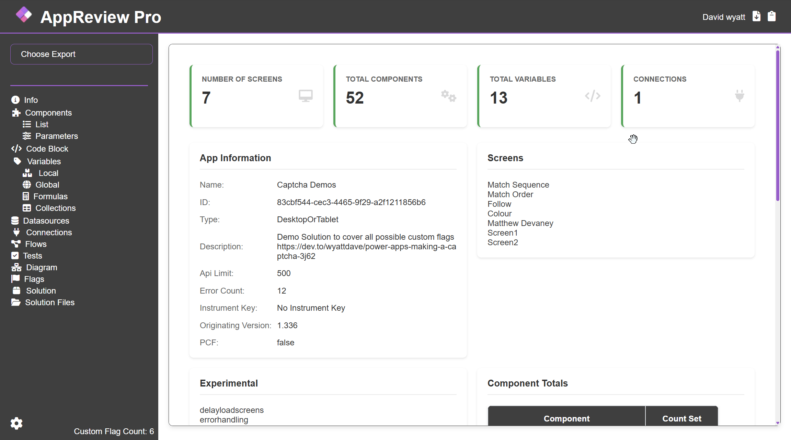
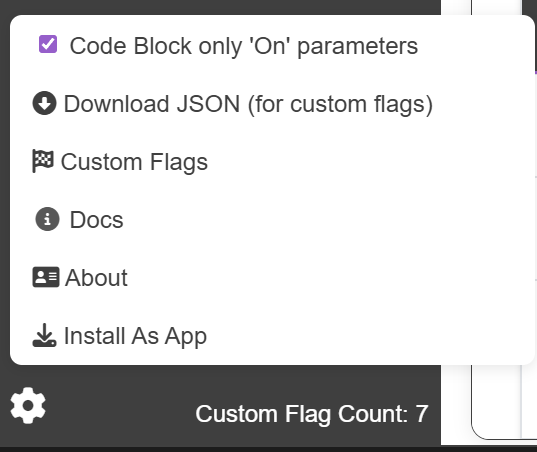

# Exports

### Page Exports

On each page there are 2 export options.

### .png>) Export to Markdown

Export to markdown convert current page to markdown and adds to your clipboard to be pasted in your documentation software. For the Diagram the svg is added to clipboard.

<figure><figcaption></figcaption></figure>

### .png>) Export to HTML

Export to html saves current page as a single page html file (no external dependencies).

### Export to HTML

There is an additional option 'Export to HTML' in the main left menu, this will export multiple screens at the same time with the exception of:

* Component Parameters (List would be to long)
* Code Block (To much information)

_These screens can be still be exported individually if needed._

### Download JSON

<figure><figcaption></figcaption></figure>

A JSON version of the report is created and can be downloaded. This can be used in external systems or ro help with creating custom flags, as this represents the oData object within the custom flag code.


[json-export-schema-odata.md](json-export-schema-odata.md)

