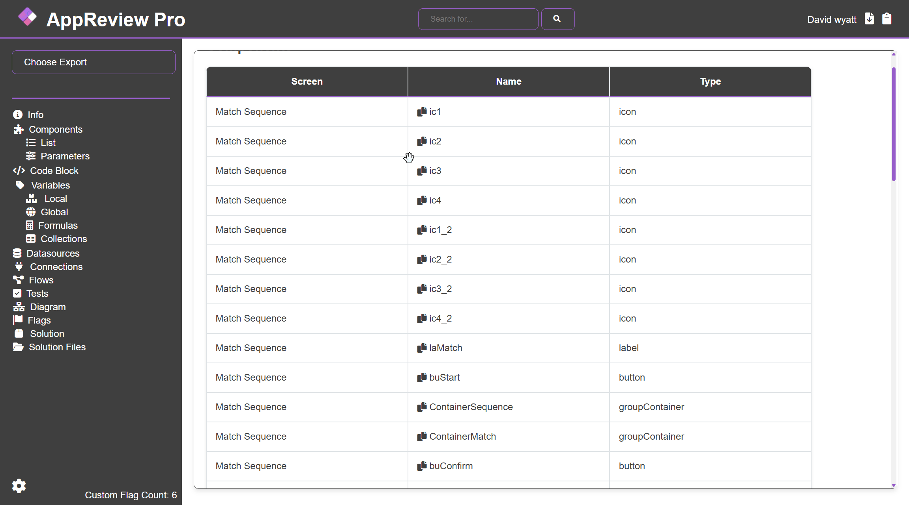

# Components

Components covers all of the components of your app, examples include gallery's, buttons, images, etc.

There are 2 pages covering components

### Component List

List is simple list of every component, it shows:

* Screen
* Name
* Type

Each component is shown once, a copy icon will be shown next to it. Clicking this adds the YAML code of the component to your clipboard, enabling you to paste it into powerapps studio.

<figure><figcaption></figcaption></figure>


The YAML code used in the add to clipboard is found in the solution. This is a relatively new update, so legacy exports may not have any YAML in the solution.

Additionally often not all components are included in the YAML files, most likely because the newness of the update. When missing YAML component you will be notified and no icon will be shown next to the missing component.


### Component Parameters

This expands on the Component List and not only includes every component but every parameter of thea  component. The table includes

* Screen&#x20;
* Name&#x20;
* Type&#x20;
* Parameter&#x20;
* Code

Parameter is the input, exampled include X, Y, Font, OnSelect, etc, and Code is the parameters value.


The search box uses the following syntax

**columnName = value**

**columnName != value (not equal to)**

**columnName includes value (in string)**

**columnName !includes value (not n string)**

