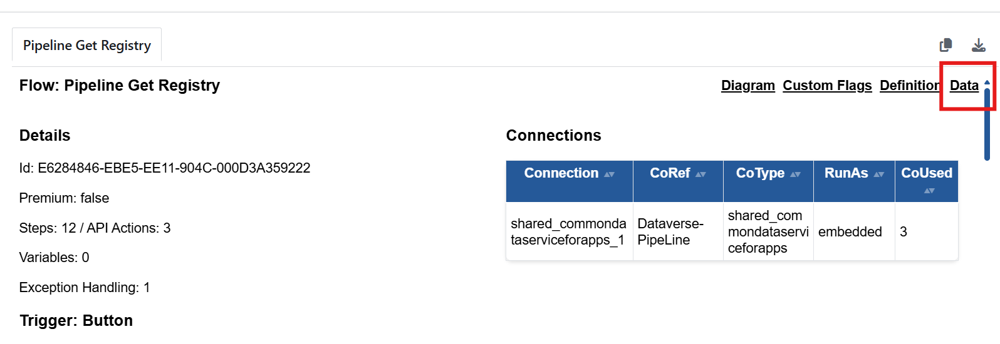

# Data

To show the tab click the link at the top of the Flow Review tab:

<figure><figcaption></figcaption></figure>

The Data JSON following structure

* **Name:** flowName
* **Unique Name**
* **ID:**&#x20;
* **Trigger**
  * Name: tirggerName
  * Data:&#x20;
  * Manual: buttonType
  * Parameters
  * Config
  * Expression
  * Inputs
  * Recurrence
  * Icon
  * Type: triggerType
  * Connection
  * Premium: Standard/Premium
  * Hash ID: unique reference to identify changes
* **Premium:** flow onwner requires premium licnese
* **Connection Count:** connectionReferences
* **Steps Count:** number of actions
* **API Actions Count**
* **Variables Count**
* **Exceptions Count:** actions with runAfter failed
* **Variable Array**
  * Name
    \
    Type
    \
    Value
    \
    SetCount
    \
    UsedCount
* **Action Array**
  * Step: action operationId
  * Type
  * ID
  * Index: order in definition JSON
  * Hash ID: unique reference to identify changes
  * Tier: standard/premium
  * Container: scope/forEach/doUnitl/condition/switch
  * Connection: _connectionName_
  * Connector Name
  * Icon
  * Environment Variables: list of environment variables
  * Environment Variables Count
  * Notes
  * Run After: what and how runs after
  * Run After Mode: how runs after
  * Exception: has runAfer Failed
  * Secure: secure inputs/outputs
  * Retry
  * Timeout
  * List
    * Filter
    * Pagination
  * Position: containers
  * Position Info: Internal/blank
  * Parent: root/container name
  * Branch: Yes/No
  * Position Index: containersIndex
  * Position Type: containerTyoe
  * Flags\*
    * Flag Name
    * Area
    * Component
    * Type
    * Level
    * Reason
* **exceptionArray:** (same as actionArray but filtered to runAfter Failed)
* **Connection Array:**
  * Connection: internalFlow Name
  * Reference Name: unique name
  * Type: connectionType
  * Run As: embedded/run only user
  * Used Count
  * Connection Reference: displayName&#x20;


\*Only if Show Custom Flags on Review or Highlight Flagged Items on Diagram settings tuned on


Full Schema:

```json
{
  "$schema": "http://autoreview-pro.dev/schema/flow/schema.json",
  "type": "object",
  "properties": {
    "name": { "type": "string" },
    "uniqueName": { "type": "string" },
    "id": { "type": "string" },
    "trigger": {
      "type": "object",
      "properties": {
        "name": { "type": "string" },
        "data": { "type": "string" },
        "manual": { "type": "string" },
        "parameters": { "type": "string" },
        "config": { "type": "string" },
        "expression": { "type": "string" },
        "inputs": { "type": "string" },
        "recurrence": { "type": "string" },
        "icon": { "type": "string" },
        "type": { "type": "string" },
        "connection": { "type": "string" },
        "premium": { "type": "string" },
        "hashId": { "type": "string" }
      }
    },
    "premium": { "type": "boolean" },
    "connectionCount": { "type": "integer" },
    "connectorsCount": { "type": "integer" },
    "stepsCount": { "type": "integer" },
    "apiActionsCount": { "type": "integer" },
    "variablesCount": { "type": "integer" },
    "exceptionsCount": { "type": "integer" },
    "variableArray": { "type": "array" },
    "actionArray": {
      "type": "array",
      "items": {
        "type": "object",
        "properties": {
          "name": { "type": "string" },
          "step": { "type": "string" },
          "type": { "type": "string" },
          "id": { "type": "string" },
          "index": { "type": "integer" },
          "hashId": { "type": "string" },
          "tier": { "type": "string" },
          "container": { "type": "boolean" },
          "connection": { "type": "string" },
          "connectorName": { "type": "string" },
          "icon": { "type": "string" },
          "environmentVariables": { "type": "string" },
          "environmentVariablesCount": { "type": "integer" },
          "notes": { "type": "string" },
          "runAfter": { "type": "string" },
          "runAfterMode": { "type": "string" },
          "exception": { "type": "string" },
          "detail": { "type": "string" },
          "secure": { "type": "string" },
          "retry": { "type": "string" },
          "timeout": { "type": "string" },
          "list": {
            "type": "object",
            "properties": {
              "filter": { "type": "string" },
              "pagination": { "type": "string" }
            }
          },
          "position": { "type": "string" },
          "positionInfo": { "type": "string" },
          "parent": { "type": "string" },
          "branch": { "type": "string" },
          "positionIndex": { "type": "string" },
          "positionType": { "type": "string" },
          "nested": { "type": "string" },
          "flags": { "type": "array" }
        }
      }
    },
    "exceptionArray": { "type": "array" },
    "connectionArray": {
      "type": "array",
      "items": {
        "type": "object",
        "properties": {
          "connection": { "type": "string" },
          "referenceName": { "type": "string" },
          "type": { "type": "string" },
          "runAs": { "type": "string" },
          "usedCount": { "type": "integer" },
          "connectionReference": { "type": "string" }
        }
      }
    }
  }
}
```
