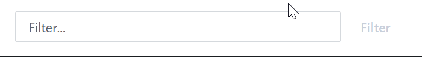

# Settings

The settings section can be found in the About tab, this can be accessed by clicking the settings cog in the top right corner.

<figure><figcaption></figcaption></figure>

The settings cog also allows you to:

* [Edit Custom Flags](pages/flag-results.md)
* [Download JSON](custom-flags/custom-data-object.md)
* Docs (here)
* About (license, bug report, and settings section
* Dark/light mode toggle
* Install App (Install site as a Progressive Web App)

### Settings Section

Currently there are 6 settings available

<figure><figcaption></figcaption></figure>

#### Copy As Markdown

When using Copy to Clipboard this sets if the output is plane text or Markdown

#### Edit Custom Flag Results

Custom flag results are generated from you custom flag code, but there maybe times when you wish to edit the results before exporting. In these case you can use the Edit Custom Flag Results setting.

<figure><figcaption></figcaption></figure>

You can also delete rows by right clicking on the row.

Not all columns can be edited, only Level and Reason. Simply click in to the cell to edit, note this will not edit all future imports, if you wish to permanently change them update the custom flag code.

#### Add Custom Flag Results

Like with the edit/remove, there maybe times when you need to add an additional flag. An example would be issues you spotted while doing a manual code review.

<figure><figcaption></figcaption></figure>

At the bottom of the table hover over and you will see the Add Row button.

<figure><figcaption></figcaption></figure>

A new row will appear and each column can be edited.


For Both Add and Edit settings a badge will appear at the top of the Flag Report to show that it has been edited.


#### Highlight Flagged Items on Diagram

This setting will show both Error's and Warning's on the Flow Diagram (Red for error, orange for warning).

<figure><figcaption></figcaption></figure>

The flag detail will also appear in the action detail panel.

<figure><figcaption></figcaption></figure>

#### Show Custom Flags on Review

Similar to Highlight Flagged Items on Diagram, but this time the flag is highlighted on the Review tab. In the 3 action tables anh action with a flag will be coloured red or amber.

<figure><figcaption></figcaption></figure>

Currently only actions are highlighted, so flags linked to variables or solution components will not be highlighted.

#### Custom Download Title

Your organisiation may require documentation to be branded. The Custom Download Title allows you to change the branding on the export html file.

<figure><figcaption></figcaption></figure>

<figure><figcaption></figcaption></figure>

It accepts HTML, so can be formatted or include images.

### Filter Shortcuts

Filter shortcuts allow you to save and quickly use common filters.&#x20;

As an example if you use 'inputs includes' a lot to check where variables are used you an assign 'inputs includes' to the shortcut key @. The pressing that key will auto populate the shortcut text.

<figure><figcaption></figcaption></figure>

You can have upto 5 different shorcuts

<figure><figcaption></figcaption></figure>
