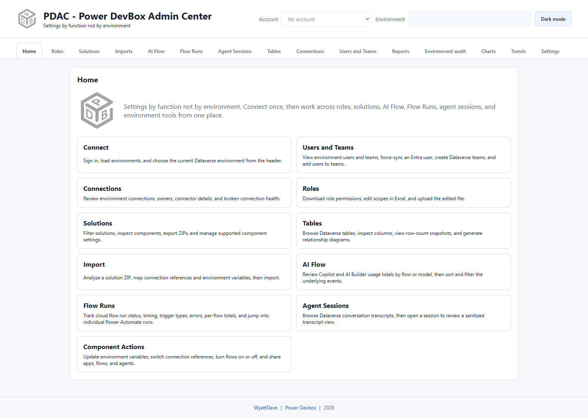

# PDAC

**Power DevBox Admin Center — settings by function, not by environment.**

PDAC brings Power Platform and Dataverse administration into one function-oriented workspace. Sign in once, select an environment, and move between security roles, solutions, tables, connections, users, activity, and reporting without starting from a different environment page for every task.

This guide covers the **Chrome extension, version 0.7.9**. The unpacked extension also supports Microsoft Edge. It runs inside the browser: you do not need Node.js, a localhost server, or Windows Task Scheduler.

*Actual extension screenshot from a clean, unsigned-in browser profile. Screenshots throughout this guide show the real interface without customer data; empty lists and disabled actions are expected before sign-in or selection. Authenticated operations are described from the extension implementation, not claimed as live-tenant validation.*

## Start here

1. [Install the extension](getting-started/installation.md).
2. [Sign in and select a test environment](getting-started/quickstart.md).
3. Start with a read-only inventory, such as [Solutions](solutions/README.md) or [Tables](tables/README.md).
4. Configure [Reports](reports/README.md) when you need cross-environment exports, [Charts](charts.md), or [Trends](trends.md).

## What can I do?

| Area | Use it for |
| --- | --- |
| [Home](home.md) | Understand the workspace and account/environment context. |
| [Roles](roles.md) | Export, edit, and apply table or miscellaneous privileges. |
| [Solutions](solutions/README.md) | Inventory solutions, inspect components, export ZIPs, and stage deployment. |
| [Imports](imports.md) | Map target connections and variables before importing a solution. |
| [AI Flow](ai-flow.md) | Review AI Builder and Copilot consumption events. |
| [Flow Runs](flow-runs.md) | Investigate failures, duration, triggers, and individual runs. |
| [Agent Sessions](agent-sessions.md) | Review session totals and open sanitized transcript details. |
| [Tables](tables/README.md) | Inspect metadata, browse records, and generate design documentation. |
| [Connections](connections.md) | Inspect connection ownership and health; repair or delete where permitted. |
| [Users and Teams](users-and-teams.md) | Sync users, create teams, manage members, and assign roles. |
| [Reports](reports/README.md) | Export across environments, schedule daily work, and review weekly changes. |
| [Environment audit](environment-audit/README.md) | Compare read-only settings and inventories across environments. |
| [Charts](charts.md) | Compare the latest report snapshots. |
| [Trends](trends.md) | Explore locally retained totals and usage forecasts. |
| [Settings](settings/README.md) | Manage accounts, environment visibility, and local trend data. |


PDAC uses your signed-in account's permissions. Some actions make real administrative changes, including role uploads, imports, sharing, ownership changes, flow state changes, and connection deletion. Test in a disposable environment and verify the account and target before writing.


## Downloads and support

The source repository currently documents **unpacked installation**; a packaged browser-store release is described as publishing soon. Do not assume that a Chrome Web Store listing already exists.

* [PDAC source and release information](https://github.com/wyattdave/pdac)
* [Report an issue](https://github.com/wyattdave/pdac/issues)
* [Troubleshooting](troubleshooting.md)
* [Privacy and permissions](privacy.md)
