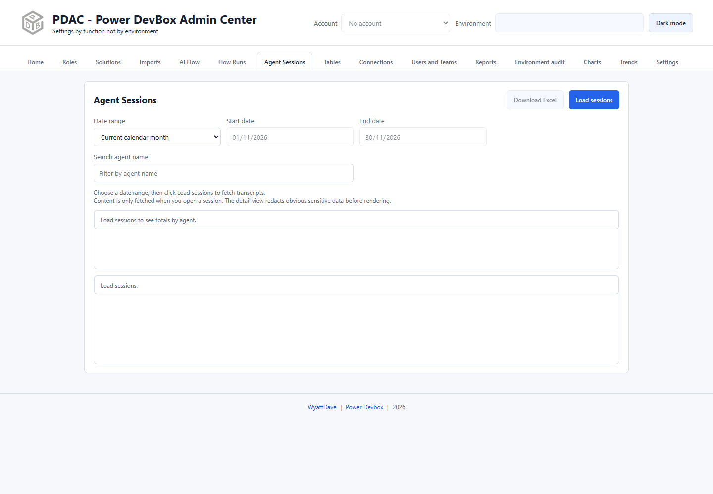

# Agent Sessions

Agent Sessions browses Copilot/Dataverse conversation sessions, shows per-agent totals, and loads transcript content only when a session is opened.

## Load sessions

1. Confirm the account and header environment.
2. Open **Agent Sessions**.
3. Choose the date range and check its start/end bounds. The initial range is the current calendar month.
4. Select **Load sessions**.
5. Use **Search agent name** to narrow the results.
6. Select **Load more** when offered to retrieve additional pages.

Read the loaded summary and per-agent totals. If more pages remain, do not mistake a partially loaded list for a complete session inventory.

## Open a transcript

Open a session from the list when you actually need its conversation details. Listing sessions does not fetch every transcript. The detail view sanitizes and redacts obvious sensitive content before rendering.


Redaction is a safeguard, not a guarantee of anonymization. Conversations may still contain personal, customer, or confidential information. Restrict access and inspect anything you copy or screenshot before sharing it.


Transcript availability depends on Dataverse retention, agent/environment configuration, and the caller's permissions. A session listed in a historic report may no longer have accessible live content.

## Export and cross-environment reporting

Use **Download Excel** for the tab's session totals. To generate cross-environment totals and raw session-row workbooks, use the **Agent Sessions** card in [Reports](reports/README.md). Do not assume those raw rows are a bulk transcript-content export.

Session charts in [Charts](charts.md) and [Trends](trends.md) can expose searchable record lists on double-click. Those lists fetch matching sessions from Dataverse for the selected period without retrieving their transcripts. Deleted/expired sessions may therefore be absent even when an older saved total remains.

For unexpected zeros, first compare environment, dates, agent filter, source retention, and permissions. A lack of visible sessions should not be interpreted as proof that an agent has never been used.
