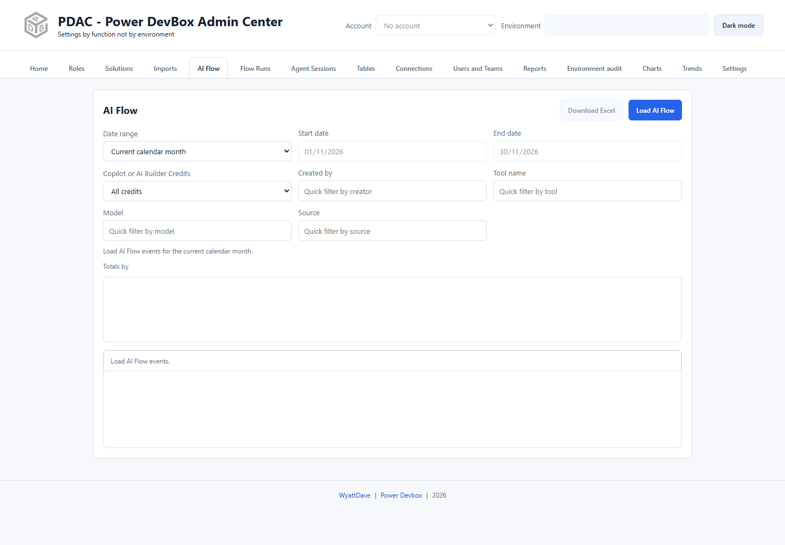

# AI Flow

AI Flow reviews AI Builder and Copilot consumption events in the selected environment. Use it to identify where credits are being consumed and compare totals by flow or model.

## Load events

1. Choose the header account and environment.
2. Open **AI Flow**.
3. Select a **Date range**. Presets include current month, previous month, **2x previous calendar month**, **3 calendar month view**, Today, Last 7/28/365 days, and Custom range.
4. Review the displayed **Start date** and **End date**; use a custom range for explicit bounds.
5. Select **Load AI Flow**.
6. Read the summary and any warnings before interpreting totals.

## Narrow the results

Use **Copilot or AI Builder Credits**, **Created by**, **Tool name**, **Model**, and **Source** to focus the loaded results. Switch **Totals by** to compare the available flow/model groupings. Sort the displayed tables as needed and open event details when the row offers them.

For example, start with one completed month, filter a particular model, then compare the contributing flows. Do not add unlike credit types together and assume the result is a monetary invoice; use Microsoft's licensing/billing sources for financial conclusions.

## Export

Select **Download Excel** after loading. Review the date bounds and filters so that a shared workbook has a clear scope. Event exports can contain creator identities and operational metadata; treat them as administrative data.

## Interactive activity versus reporting

This tab queries one header environment. [Reports](reports/README.md) can run the corresponding report across checked environments and produce raw and/or totals workbooks.

The reporting pipeline uses completed calendar days and excludes today's partial activity. Do not assume an interactive **Today** query will match a scheduled completed-day snapshot. For historical comparisons and forecasts, enable saved trend data and use [Trends](trends.md).


An empty or incomplete result can reflect source retention, unavailable data, permissions, or the chosen date range. Check warnings and compare the same environment and bounds before concluding that no AI activity occurred.

