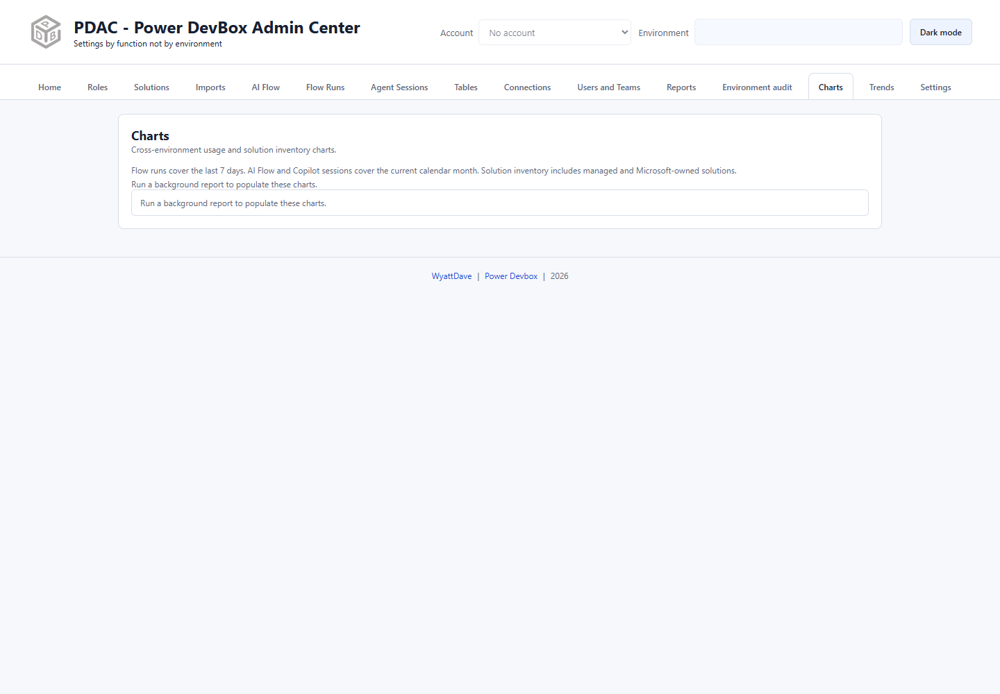

# Charts

Charts compares the latest available cross-environment report snapshots. It is not a live replacement for running the source reports.

*A clean installation has no cached chart data. This empty state is expected before reports complete.*

## Populate charts

1. Sign in and load environments.
2. In [Reports](reports/README.md), select environments in the relevant cards.
3. Run the required reports and wait for completion.
4. Open **Charts** and review its status and inventory totals.

The dashboard covers AI usage, flow-run health, sessions, and solution/component inventory. Its period note distinguishes **last-seven-day flow runs** from **current-calendar-month AI Flow and Copilot sessions**. Solution inventory includes managed and Microsoft-owned solutions; do not compare it with a filtered unmanaged-only solution list without reconciling the scope.

Use the latest status/data availability to distinguish a real zero from a missing report. Changes made directly in Microsoft tools do not instantly rewrite a locally cached report snapshot.

## Drill into supported records

Double-click an eligible solution, solution-component, or agent-session bar when its tooltip offers **Double-click to see records**. The modal provides search and paginated record lists, in pages of 100.

* Solutions can show version, publisher, management type, and IDs.
* Components can show type, containing solution, names, and IDs.
* Sessions show agent, start time, and conversation ID without fetching transcript content.

AI-event and flow-run charts do **not** support this record drilldown. Use [AI Flow](ai-flow.md) or [Flow Runs](flow-runs.md) for their detailed rows.

## Historic-data caveats

New Solutions reports retain daily record inventories alongside totals. Older data may have only names or totals; a record popup explicitly labels a fallback to the latest inventory. Such a fallback should not be interpreted as an exact record-level reconstruction of an older day.

Session record lists are fetched from Dataverse for the selected period. Expired/deleted sessions may no longer be available even though their previously saved totals remain.

For changes over time and date-range comparison, use [Trends](trends.md). For environment configuration comparisons rather than report metrics, use [Environment audit](environment-audit/README.md).
