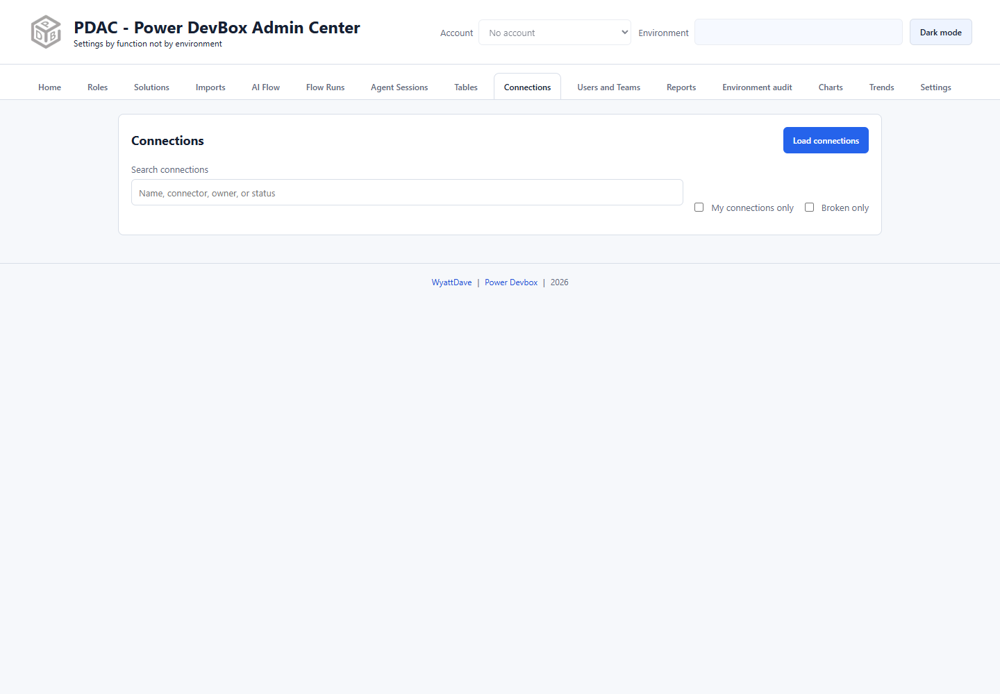

# Connections

Connections lists environment connections with connector, owner, and health information. It helps identify broken connections and open eligible repairs in Power Apps.

## Review connection health

1. Check the header account and environment.
2. Open **Connections** and select **Load connections**.
3. Search by connection name, connector, owner, ID, or status.
4. Use **My connections only** to focus on the selected account's connections.
5. Use **Broken only** to narrow to connections reported as unhealthy.

The list reflects what the API exposes to your account; it is not a guarantee of every connection in the tenant. Verify the owner before trying to repair a connection.

## Repair an owned broken connection

1. Find the broken connection owned by the selected account.
2. Select **Broken - Click to Fix** when offered.
3. Complete reauthentication or repair in the Power Apps page that opens.
4. Return to PDAC and reload connections to check its health.

PDAC opens the repair experience; it does not collect another owner's credentials or bypass connector consent requirements. If the connection belongs to someone else, coordinate with that owner or your administrator.

## Delete a connection

1. Confirm the connection ID, owner, and environment.
2. Check which apps and flows depend on it using your normal administration tools.
3. Select **Delete**.
4. Read the confirmation and select **Delete connection** only when removal is intended, or **Cancel** to leave it unchanged.


Deletion removes the real connection from Power Apps/Power Automate. Apps and flows using it may stop working. A connection export or solution ZIP is not a backup of its credentials, and deletion is not a repair technique.


Connections are different from **connection references**. To change which existing connection a solution reference uses, see [Component actions](solutions/component-actions.md). To map a reference during deployment, see [Imports](imports.md).
