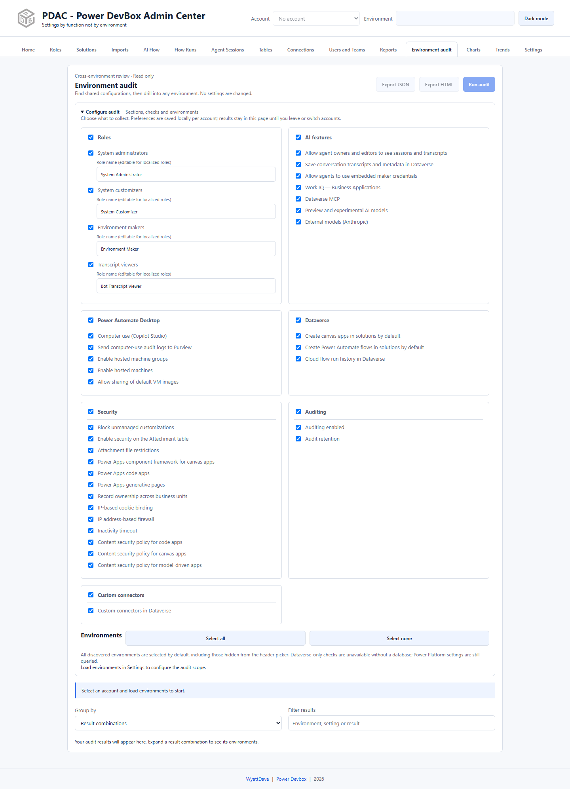

# Environment audit

Environment audit compares selected settings, role assignments, and connector inventories across environments. It is an interactive **read-only** collection, not a settings editor or scheduled report.

## Configure and run

1. Sign in and load environments in Settings.
2. Open **Environment audit** and expand **Configure audit**.
3. Toggle whole sections or individual checks. Adjust role names if needed for localized/custom names.
4. Review the audit environment selection. **All discovered environments are initially selected, including those hidden from the header picker.** Use Select all/Select none deliberately.
5. Select **Run audit** and keep the page open.
6. To finish early, use **Stop after current**. Results collected so far are retained as a partial run.

The collector reads selected environments in sequence without changing the current header environment. Dataverse-only checks require a database; Power Platform management/governance checks are still attempted for environments without one.

## Explore results

* **Result combinations** groups equal results independently for each check, showing an environment count. Expand a combination, then select an environment to inspect all checks included in that run.
* **Environment** presents an environment-first table with read/unavailable/error counts and collection times.
* **Filter results** searches environment names, IDs, URLs, check names, and displayed results.

Environment details group checks into categories and show source fields and collection time. Role assignments keep identity, status, and type separate so equally named principals are not automatically treated as the same person.

## Understand section ratings

Ratings measure **consistency, not security compliance**. PDAC finds the largest group with the same complete, readable pattern across the selected checks in a section:

| Rating | Largest matching group |
| --- | --- |
| Pass | 100% |
| Warning | 60% to below 100% |
| Fail | Below 60% |

Unavailable/error/missing fields do not count as a matching readable pattern. Ratings use all collected environments, regardless of search/grouping. A running or stopped collection rates only the environments collected so far. Consistently unsafe settings can still receive a consistency Pass.

## Export and retention

**Export JSON** includes configuration, values, sources, timestamps, errors, and completion/partial status. **Export HTML** creates a standalone offline/printable report with ratings and all collected details, regardless of the current search filter.

Preferences save locally per account. Results remain in page memory, not the report/trend database; refresh, account switch, and logout clear them. Export what you need before doing so. Changing configuration does not retroactively change collected results: run the audit again.

Both exports can contain identities and sensitive environment security settings. See [Audit checks and limitations](checks.md) before interpreting a missing value as disabled or an inventory as complete.
