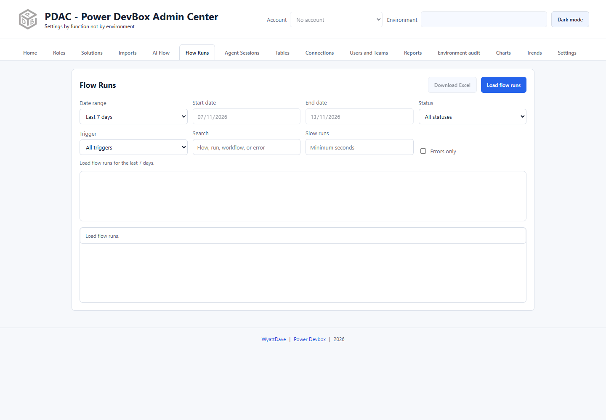

# Flow Runs

Flow Runs investigates cloud-flow execution health in the selected environment. It combines individual run rows with per-flow success, failure, and duration totals.

## Load and investigate

1. Confirm the header account and environment.
2. Open **Flow Runs**.
3. Choose a date preset or Custom range. **Last 7 days** is the initial selection.
4. Check the start and end dates and select **Load flow runs**.
5. Read the overall summary and per-flow totals before drilling into a particular run.

Useful filters include:

| Control | Purpose |
| --- | --- |
| Status | Isolate a returned run status |
| Trigger | Focus on a trigger type |
| Search | Match flow, run, workflow, or error text |
| Slow runs | Set a minimum duration in seconds |
| Errors only | Focus on rows containing errors |

For example, start with Errors only, search for a known failure phrase, then remove that search and set Slow runs to identify a different performance issue. Keep the date scope constant when comparing results.

## Open or export a run

Use the offered run link to open the individual execution in Power Automate. PDAC does not rerun or repair the flow from this reporting view; inspect the Microsoft run details for inputs, outputs, and remediation.

Select **Download Excel** for an export after loading. Error text and flow names may be sensitive, so review the file before sharing.

## How Reports differs

The **Flow Runs** card under [Reports](reports/README.md) covers the last seven days across selected environments. Its **Run totals** output summarizes run health; **Run failed runs** produces raw failed-run rows only. That raw report is not a full export of every successful run.

Charts of flow runs do not support record-list double-click drilldown. Use this tab and the Power Automate links for individual execution investigation.

If runs are missing, check the source's retention/availability, account permissions, environment, date bounds, and active filters. A zero result is not proof that flows never ran.
