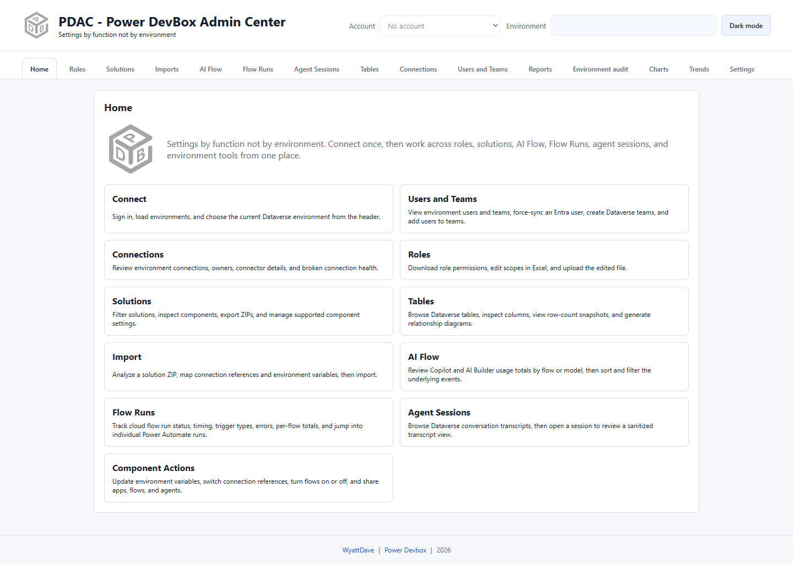

# Install the Chrome extension

The extension contains PDAC's interface, API implementation, and runtime libraries. Installing it does not require the Node version or a local web server.

## Requirements

* Chrome 114 or newer, or a compatible Microsoft Edge version.
* Permission to load unpacked extensions. Your organization may restrict Developer mode or extension installation.
* A Microsoft work or school account with access to the Power Platform environments you intend to administer.
* Network access to Microsoft sign-in, Dataverse, and Power Platform endpoints. See [Privacy and permissions](../privacy.md).

Dataverse-based functions need an environment with a database and appropriate privileges. Signing in does not grant additional administrative rights. The implemented endpoint support is for the commercial cloud; do not assume sovereign-cloud compatibility.

## Load the extension

1. [Download the repository ZIP](https://github.com/wyattdave/pdac/archive/refs/heads/main.zip) and extract it to a permanent local folder, or clone the repository.
2. In Chrome, open `chrome://extensions`. In Edge, open `edge://extensions`.
3. Turn on **Developer mode**.
4. Select **Load unpacked**.
5. Choose the extracted **chrome-ext** folder. Do **not** choose the repository root or the ZIP file.
6. Optionally pin PDAC from the browser's Extensions menu.
7. Select the PDAC toolbar icon. It opens the full-page app in a browser tab.

*Expected result: Home opens with the complete navigation. A clean installation has no selected account or environment.*

## Update an unpacked installation

1. Export any trend totals you need to keep using [Settings → Trend data](../settings/trend-data.md).
2. Download the newer source and update the files in the same extension folder.
3. Open the browser's extensions page and select **Reload** for PDAC.
4. Reopen the PDAC tab. Review any new permission request before accepting it.

Keep the extension folder in place: the browser loads the unpacked files from it. Loading from a different location or removing/reinstalling the extension can create a separate installation or remove local data. Do not use removal as a routine update step.

## What installation does not do

It does not install Node.js, create a Windows startup task, start a localhost listener, or set up an always-on reporting service. [Scheduled reports](../reports/scheduling.md) use the browser's background service worker and require Chrome or Edge to remain running.

Next: [First sign-in and quickstart](quickstart.md).
