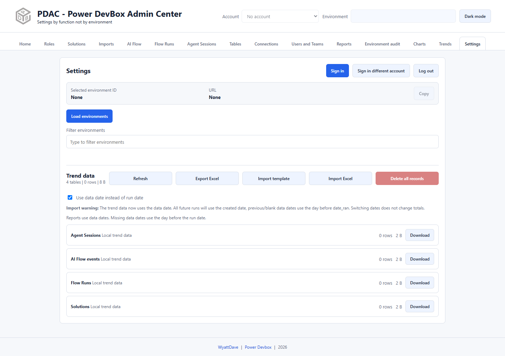

# First sign-in and quickstart

This walkthrough gets you from a new extension to your first read-only inventory. Use a development environment for the initial check.

## 1. Sign in

1. Open PDAC from its toolbar icon.
2. Select **Settings**.
3. Select **Sign in** and complete the Microsoft sign-in tab, including any organizational requirements.
4. To choose another identity explicitly, use **Sign in different account**.

*Settings before sign-in. Environment details populate after discovery and selection.*

The extension captures the Microsoft redirect to `http://localhost:5500/` from the sign-in tab; nothing needs to listen on that port. A brief connection-refused page can appear while the redirect is captured. Do not install or start a server to fix that transient page. If sign-in does not complete, see [Troubleshooting](../troubleshooting.md).

## 2. Select an environment

1. Check the **Account** selector in the header.
2. Environment discovery normally runs after sign-in. If necessary, select **Load environments** in Settings.
3. Filter the environment list and select the environment you intend to inspect.
4. Confirm the **Selected environment ID** and **URL** in Settings.
5. Use the header **Environment** picker to switch later. It has its own search field.

Most administration tabs use this header selection. **Imports** has a separate target selector, and **Reports** and **Environment audit** have their own multi-environment selections. Never infer their target solely from the header.

## 3. Load a read-only inventory

1. Open **Solutions**.
2. Select **Load solutions**.
3. Search for a familiar solution and select it.
4. Select **List components** to inspect its inventory.

Expected result: a solution list and selected solution details appear. Loading and listing do not import, share, or change the solution. Exporting is a separate action; **Deploy** stages a ZIP for Imports rather than silently deploying it.

## 4. Try a report when ready

1. Open **Reports**.
2. In one report card, select a small set of environments you can read.
3. Select **Run totals** and watch the report queue.
4. Download the completed workbook from that card.
5. Enable **Enable trend data to be saved** before future runs if you want historical charts.

Do not enable daily scheduling until a manual run succeeds. See [Reports](../reports/README.md) for date rules, queue behavior, and report types.


An empty result is not automatically a problem. Check permissions, environment/database availability, date range, and filters before concluding that there are no records.

