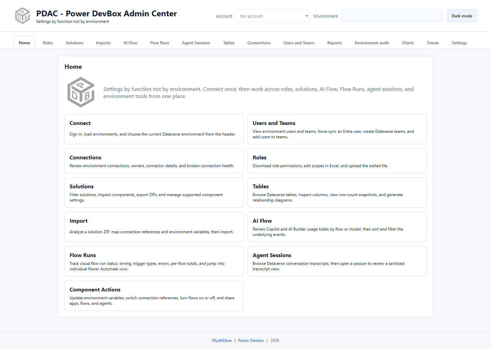

# Home and navigation

Home is the orientation page, not a live dashboard. Its cards explain the available functions; use the tabs across the top to open them.

## Global controls

* **Account** selects a cached Microsoft identity. Verify it before loading data or making changes.
* **Environment** opens a searchable environment picker for the selected account. The chosen Dataverse environment supplies the context for ordinary administration and activity tabs.
* **Dark mode / Light mode** changes the display theme; it does not change permissions or the selected environment.

## Choose the right scope

| Task | Where its environment comes from |
| --- | --- |
| Roles, Solutions, Tables, Connections, Users and Teams | Header environment |
| AI Flow, Flow Runs, Agent Sessions | Header environment and the section's date range |
| Imports | Explicit **Target environment** in Imports |
| Reports | Environments checked separately inside each report card |
| Weekly report | Solutions report environment selection, then report filters |
| Environment audit | Audit configuration's own environment selection |
| Charts and Trends | Available report data for the selected account, not just the header environment |

The header picker can hide environments for convenience. That is not a permission boundary, and it does not automatically exclude them from an audit. Review the selection in each cross-environment workflow.

## A safe working pattern

1. Confirm the account and environment.
2. Load the relevant list.
3. Search, filter, and select the intended record.
4. Review IDs, managed state, business unit, or owner as appropriate.
5. Perform the requested action and read its result.
6. Reload or verify in the Microsoft portal when making changes.

Loading a list and changing a record are distinct actions. Some operations apply immediately when selected; do not assume every administrative button has an additional confirmation dialog.

For comparisons, use [Charts](charts.md) for the latest snapshot, [Trends](trends.md) for historical totals, and [Environment audit](environment-audit/README.md) for configuration consistency.
