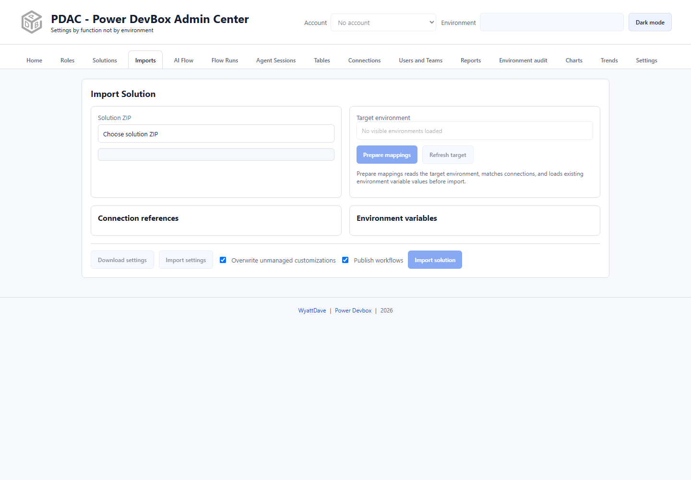

# Imports

Imports analyzes a solution ZIP, reads a target environment, and prepares connection-reference and environment-variable mappings before submitting the import.



## Prepare a package

1. Choose **Solution ZIP**, or use **Deploy** from [Solutions](solutions/README.md).
2. Review the package summary.
3. In **Target environment**, search by name, environment ID, or URL. Click a result, or use the arrow keys and Enter; Escape closes the list.
4. Confirm that this is the intended target. It is not automatically the header's current environment.
5. Select **Prepare mappings**.

Preparation reads target connections and existing variable values; it is not the final import. Changing the target invalidates prepared mappings, so prepare again after any target switch.

## Review mappings

For each **Connection reference**, choose a compatible target connection. If needed, use **Create connection**, complete Power Apps' browser flow, and **Refresh target** before selecting the new connection. A reference must point to a suitable target connection, not a source-environment credential.

For each **Environment variable**, review the existing/default value and enter the desired target value. Pay particular attention to URLs, identifiers, and any environment-specific settings.

## Reuse deployment settings

**Download settings** exports the prepared mappings as JSON; **Import settings** reads a settings file. Recheck all imported values against the current target. A settings file is not a solution ZIP or a credentials transfer.

```json
{
  "EnvironmentVariables": [
    { "SchemaName": "demo_ServiceUrl", "Value": "https://example.com/service" }
  ],
  "ConnectionReferences": [
    {
      "LogicalName": "demo_DataverseConnection",
      "ConnectionId": "00000000000000000000000000000000",
      "ConnectorId": "/providers/Microsoft.PowerApps/apis/shared_commondataserviceforapps"
    }
  ]
}
```

These are placeholders; use the names discovered from your package and IDs from the target environment. Treat exported values as potentially sensitive.

## Submit the import

1. Review **Overwrite unmanaged customizations** and **Publish workflows**. Both are initially checked in this version; do not leave them selected without considering their effect.
2. Confirm account, target, solution version, managed/unmanaged package type, connections, and variables.
3. Select **Import solution** and read the status/result.
4. Verify the target solution and affected apps/flows in the Microsoft portals.


Importing changes the target environment. Mapping preparation is not a guarantee that every dependency, privilege, or solution-layer requirement will pass. There is no documented automatic rollback; follow your normal backup and application-lifecycle process.

