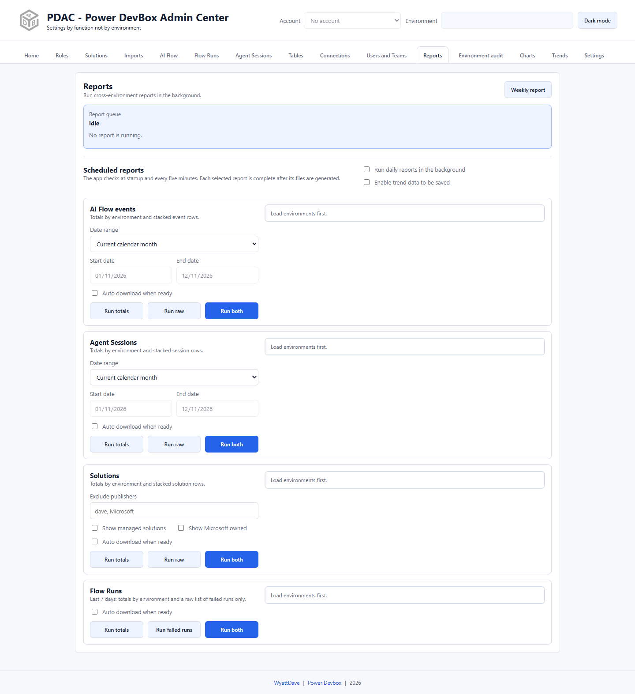

# Reports

Reports generates Excel workbooks across selected environments, queues manual runs, restores cached downloads, and optionally saves totals for historical charts.

## Run a report manually

1. Sign in and load environments in Settings.
2. Open **Reports**.
3. Find the required report card and select its environments. Each card has its own selection; the header environment is not the report scope.
4. Review the card's date bounds or inventory filters.
5. Choose **Run totals**, **Run raw**, or **Run both**, as available.
6. Watch the **Report queue** for running/completed/error status.
7. Download the completed files from that report's card.

Manual requests are queued. Do not repeatedly submit the same request because a larger environment is still processing.

## Report types

| Card | Scope and outputs |
| --- | --- |
| AI Flow events | Selected date range; totals by environment and stacked event rows |
| Agent Sessions | Selected date range; totals by environment and stacked session rows |
| Solutions | Inventory totals and solution rows; publisher exclusions and managed/Microsoft-owned options |
| Flow Runs | Last seven days; totals plus a raw list of **failed runs only** |

The Flow Runs raw button is labelled **Run failed runs**. **Run both** provides its corresponding totals and failed-run workbook, not every successful execution.

For Solutions, review **Exclude publishers**, **Show managed solutions**, and **Show Microsoft owned**. Automated inventory excludes the Active Solution. Differences between these filters and Charts' inventory scope can change the displayed totals.

## Date and completion rules

Event, session, and flow-run reports use **completed calendar days**, excluding today's partial activity. They reconstruct cumulative daily snapshots from timestamped source rows. Matching account/environment/data-date snapshots are refreshed instead of duplicated.

The report card shows only its **most recent completed run**. A Run both result may have two related files; older runs are not listed alongside it. A run is complete only after workbook generation and, when enabled, its trend snapshot are committed.

## Choose the next step

* [Daily scheduling and downloads](scheduling.md): browser alarms, retries, and auto-download behavior.
* [Weekly report](weekly-report.md): three-month solution change history and printable HTML.
* [Charts](../charts.md): latest cross-environment comparisons.
* [Trends](../trends.md): retained historical totals and forecasts.


**Run daily reports in the background** and **Enable trend data to be saved** are independent. Turning on scheduling alone is not the same as enabling historical trend retention.

