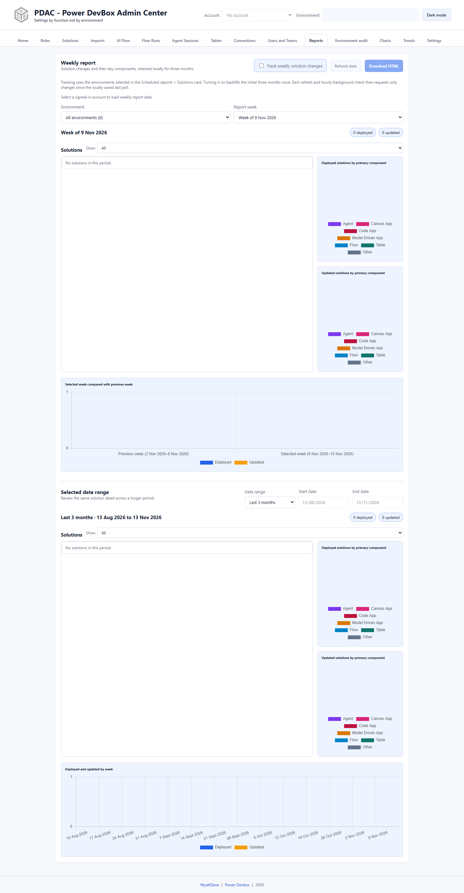

# Weekly report

The weekly report tracks created and modified solutions and their key components for **three months**. It is opened from Reports rather than a separate top-level tab.

*Empty local history in a clean profile. Populated report tables and charts require collected solution data.*

## Configure and open

1. In **Reports → Solutions**, select the environments to track and review publisher/ownership filters.
2. Select **Weekly report**.
3. Review the status for locally saved events. PDAC opens its dedicated local stores first and selects the newest populated week.
4. Enable **Track weekly solution changes** if you want ongoing collection.
5. Select **Refresh data** when you need a manual update.

When available, a Solutions report saved to trend data also populates weekly event/component stores from the inventory it already collected. Otherwise, enabling tracking performs the initial three-month backfill once. Subsequent refreshes and hourly browser checks resume from a per-environment local poll cursor with a short overlap; they do not repeatedly query three months of solutions each day.

The browser must still be running for hourly background checks. Review the status if existing Solutions report filters hide saved events.

## Read the report

Select **Environment** and **Report week**. Each period combines a sortable solution table, an **All / Deployed / Updated** filter, and primary-component charts. Tracked component types include agents, canvas apps, code apps, model-driven apps, flows, and Dataverse tables.

Rows identify **Deployed** and **Updated** events. A modification counts as an update only when its calendar day differs from creation, avoiding import-processing timestamp differences being counted twice. This is solution timestamp/inventory tracking, not a complete deployment pipeline or source-control audit trail.

Use **Selected date range** for a broader period: recent weeks/months, previous-calendar-month options, three-calendar-month view, or custom bounds within the retained history.

## Download or print

Select **Download HTML** after data is available. The self-contained report can be opened offline, printed, or saved as PDF through the browser's print dialog. Its print layout targets A4 portrait, preserves chart colors and side-by-side charts, and avoids splitting chart cards and individual rows where possible.

The HTML contains environment and solution metadata. Store and share it as an administrative report. Exporting trend totals is not a backup of the dedicated weekly event/component stores.
