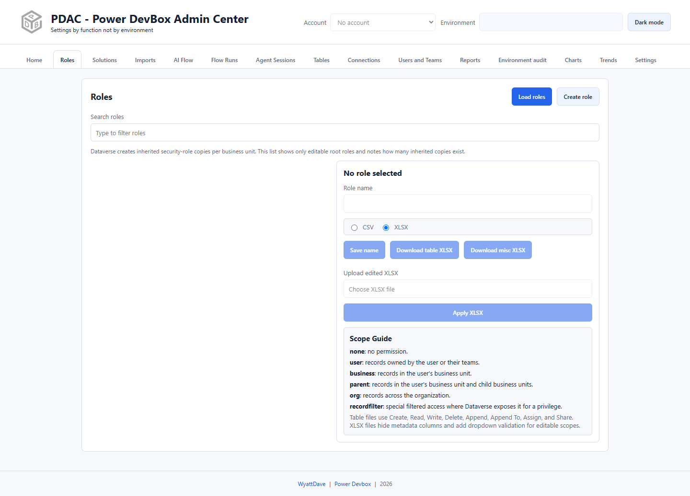

# Roles

Use Roles to create or rename editable Dataverse security roles and manage privileges through CSV or Excel files. To assign a role to a principal, use [Users and Teams](users-and-teams.md) instead.

## Load and select a role

1. Sign in and choose the correct header environment.
2. Open **Roles** and select **Load roles**.
3. Use **Search roles**, then select the intended role.
4. Check its name, ID, and business unit before downloading or applying permissions.

Dataverse creates inherited role copies for business units. PDAC lists editable **root roles** and indicates inherited copies rather than treating each copy as a separately editable root.

## Create or rename

Select **Create role** to enter the name, business unit, description, core-table privilege summary, member privilege inheritance, and whether to include app-opening privileges. Submit only after confirming that this is a new role you intend to create.

For an existing selected role, edit **Role name** and select **Save name**. This changes the role's name; it does not assign the role to users.

## Edit privileges using a file

1. Select **XLSX** or **CSV**. Button labels and accepted upload type follow this selection; XLSX is the default.
2. Download the table permissions file and/or miscellaneous privileges file. Keep an unchanged backup.
3. Edit only the intended permission cells. Retain headers, role identifiers, privilege identifiers, and workbook structure. XLSX hides metadata columns and adds scope dropdown validation.
4. Recheck the signed-in account, environment, selected role, and the file's role ID.
5. Choose the edited file under **Upload edited XLSX/CSV**.
6. Select **Apply XLSX/CSV** and read the applied-privilege result.
7. Reload and export again to verify the resulting permissions.

| Scope | Meaning |
| --- | --- |
| `none` | No permission |
| `user` | Records owned by the user or their teams |
| `business` | Records in the user's business unit |
| `parent` | Records in that business unit and its child business units |
| `org` | Records across the organization |
| `recordfilter` | Special filtered access where Dataverse supports it |

Table files include Create, Read, Write, Delete, Append, Append To, Assign, and Share. Do not assume every scope is valid for every privilege.


Applying a file is a real privilege update using Dataverse's `ReplacePrivilegesRole` action. It is not a harmless preview. The file's embedded role ID takes precedence over the selected-role fallback, so never upload another role's file without reviewing its metadata. Preserve backups and test on a non-production role first.

