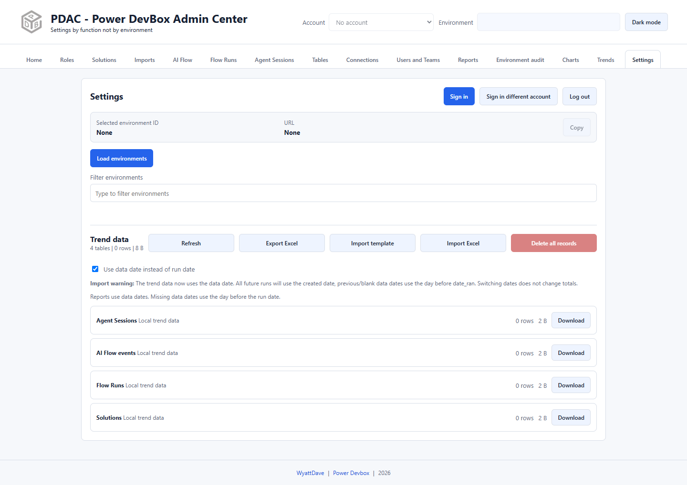

# Settings, accounts, and environments

Settings handles Microsoft sign-in, environment discovery, header-picker visibility, selected-environment details, and local trend-data controls.

## Accounts

* **Sign in** starts the normal Microsoft authentication flow.
* **Sign in different account** explicitly opens the account chooser.
* The header **Account** selector changes the active cached identity.
* **Log out** clears cached sign-in accounts in this implementation. It is not a full browser sign-out and should not be confused with deleting all local report/trend data.

Complete organizational consent/MFA requirements normally. PDAC cannot bypass tenant policies, grant its own administrative privileges, or make another person's environment visible simply by switching UI sections.

## Environment discovery and visibility

1. Choose the correct account.
2. Select **Load environments** if the discovery list needs refreshing.
3. Use **Filter environments** to locate a name/ID/URL.
4. Select an environment and verify **Selected environment ID** and **URL**.
5. Use **Copy** when you need those details for your own administrative work.
6. Use the list's visibility controls to decide which environments appear in the header picker.

Hiding an environment is a local convenience, not access revocation. In particular, the audit initially includes all discovered environments, even those hidden from the header. Report cards and Imports also have their own target scope.

Most Dataverse functions require a selected environment with an organization URL. An environment without a database can still support some management/governance audit checks; do not treat the two scopes as interchangeable.

## Trend data

The lower section lists the extension's four report-total stores: Agent Sessions, AI Flow events, Flow Runs, and Solutions. It shows row counts/sizes and offers Refresh, Export Excel, Import template, Import Excel, and Delete all records.

**Use data date instead of run date** changes chart date placement without changing totals. For detailed import/replacement/deletion behavior, see [Manage trend data](trend-data.md).

## Before switching context

Export any in-memory [audit results](../environment-audit/README.md) you need before account switch/logout or page refresh. Close a table-data viewer and reopen it in the new context. Reload administration lists when required rather than assuming data loaded for one environment belongs to another.
