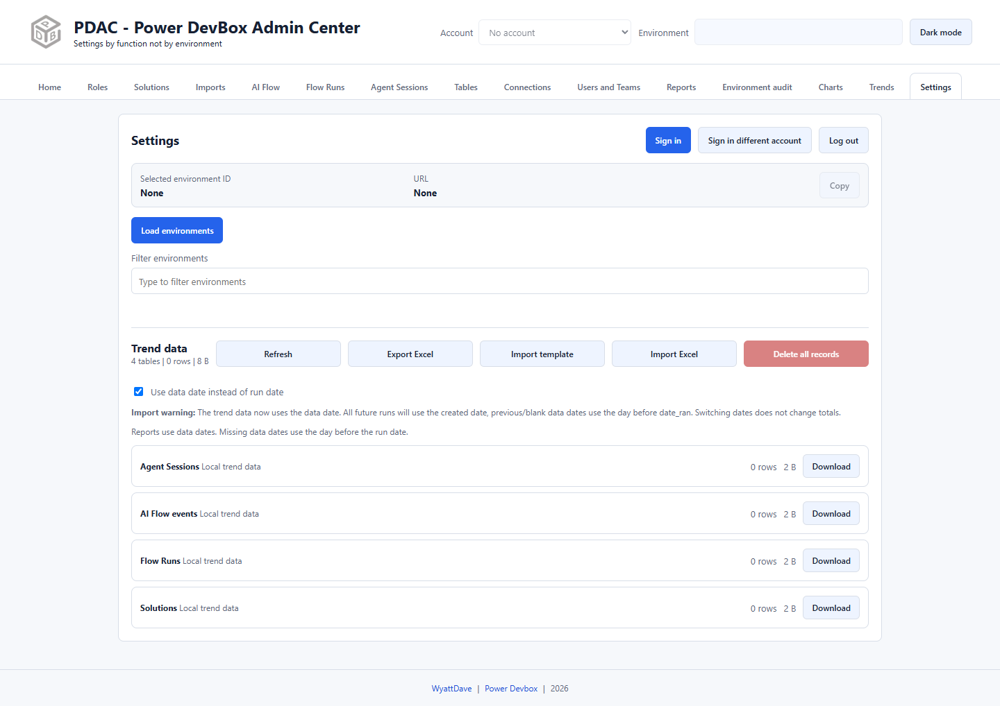

# Manage trend data

Open **Settings → Trend data** to inspect and transfer locally saved report totals. The extension uses IndexedDB; the UI's store/table language does not mean you need to install or manage a SQL server.

## Inspect or export

1. Select **Refresh** to reload row counts and sizes.
2. Use a store's **Download** button for that report's Excel data.
3. Use **Export Excel** for the combined supported workbook.
4. Store a backup outside the browser profile before clearing data or reinstalling.

The combined export is generated from the same template as the importer, so supported worksheet names and headers align. It transfers totals, not credentials, report-file caches, schedules, dedicated weekly events/components, or record-level chart inventories.

## Import a workbook

1. Export a backup of the destination's current totals.
2. Select **Import template** for a blank supported workbook, or use a combined export from another PDAC instance.
3. Keep worksheet names, headers, and instructions unchanged. Enter values in the intended report worksheets rather than inventing a new layout.
4. Review account/environment identifiers and dates carefully so rows belong to the intended snapshot.
5. Select **Import Excel** and choose the `.xlsx` file.
6. Read the imported/replaced-row result and inspect Trends.

For each report, account, and imported date, imported rows **replace the complete existing date snapshot**. This prevents duplicate-date counting but also means importing a partial snapshot can replace more destination rows than intended. Imported data follows the same two-year history policy as generated totals.

Older supported exports/templates without `data_date` remain importable. Missing dates use the day before `date_ran`; explicit dates and numeric totals are retained.

## Data date versus run date

**Use data date instead of run date** changes chart date placement only. Data date reflects the source snapshot/activity date; run date reflects when collection ran. Switching does not recalculate consumption or make incomplete source data complete.

## Delete local totals

Select **Delete all records**, inspect the confirmation's counts, and confirm only after backing up. This clears records from the local trend tables while keeping their schema. It is not a request to delete Dataverse records, and it is not a full account logout or documented full-extension data wipe.

If the browser profile is lost or the extension storage is cleared without an export, do not assume another installation has a synchronized copy. See [Privacy and permissions](../privacy.md).
