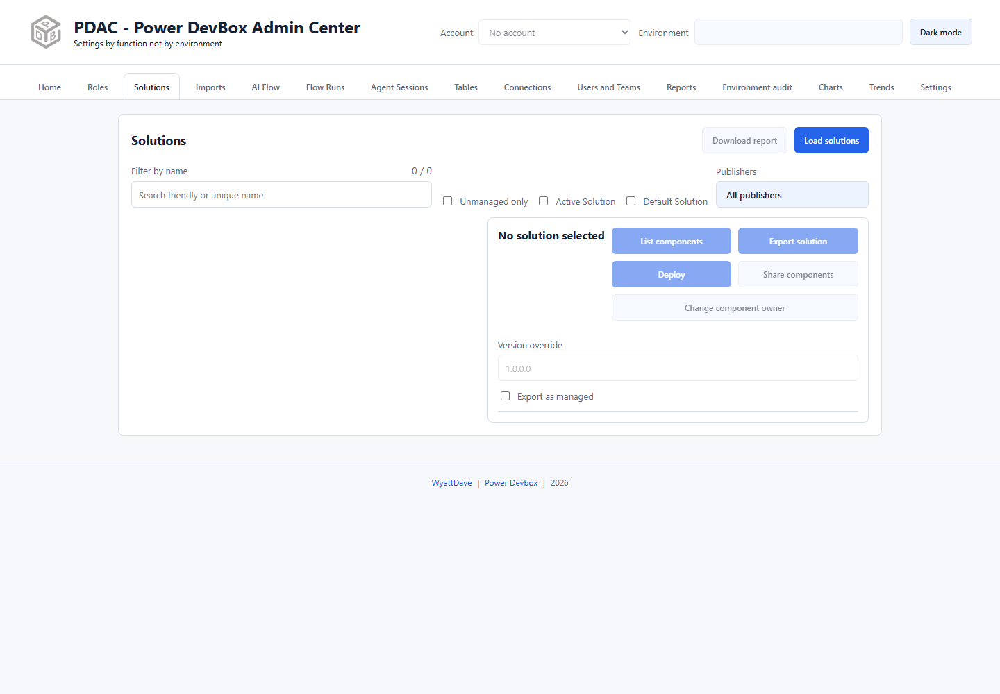

# Solutions

Use Solutions to inventory an environment, inspect components, export a solution, or stage a ZIP for deployment. You need read access for inventory and the appropriate Dataverse privileges for exports and administrative actions.

## Find a solution

1. Check the header account and environment.
2. Select **Load solutions**.
3. Search by friendly or unique name.
4. Optionally enable **Unmanaged only**, include **Active Solution** or **Default Solution**, and narrow **Publishers**. The publisher dropdown includes **Select all** and **Select none**.
5. Select a solution and review its version, publisher, and managed state.

The visible count helps distinguish the filtered list from the loaded inventory. **Download report** exports the solution inventory. Links on a selected solution open the corresponding Power Apps, Power Automate, or Copilot Studio portal.

## Inspect components

Select **List components**, then use **Search components** to narrow by type or name. Supported components expose management actions; not every solution component has an editable manager.

* [Component actions](component-actions.md): environment variables, connection references, flows, and supported sharing.
* [Share components and change ownership](access.md): solution-wide operations and important boundaries.

If the solution contains table components, **Create diagram** and **Create table** become available. The diagram includes solution tables and directly related lookup dependencies, with external dependencies highlighted. See [Tables](../tables/README.md).

## Export or prepare a deployment

1. Select the intended solution.
2. Review **Version override** and **Export as managed**.
3. Select **Export solution** to download the ZIP, or **Deploy** to export and send that ZIP into the Imports workflow.
4. For Deploy, review the separate target, mappings, and options in [Imports](../imports.md). Deployment is not complete until an import is submitted and succeeds.

Export uses the Dataverse `ExportSolution` action. Export type must be supported by the source solution; selecting an option does not bypass Dataverse restrictions.


Do not confuse **Share components** with sharing a solution record, or **Change component owner** with changing only the selected solution's owner. These operations discover and update compatible components and can reach linked agent dependencies outside the solution. Review [the access guide](access.md) before using them.

