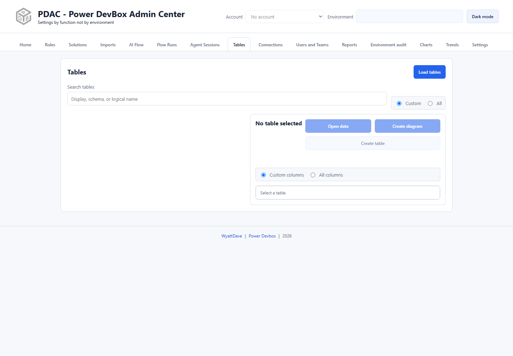

# Tables

Tables combines Dataverse metadata inspection, a paged data browser, relationship diagrams, and table-design exports. **Create table** creates a design document; it does not create a new Dataverse table.

## Inspect metadata

1. Select the account and header environment.
2. Open **Tables**.
3. Choose **Custom** or **All**, then select **Load tables**.
4. Search by display, schema, or logical name.
5. Select a table to load its details and columns.
6. Choose **Custom columns** or **All columns** according to the detail you need.

Review logical names as well as display names when diagnosing schema issues. Row counts are snapshots rather than a guarantee of a live transactional count. **Open in Power Apps** opens the selected table in the maker portal.

## Browse records

Select **Open data** on the selected table. The viewer uses 100-row API pages and offers server-side filters and sorting, plus local column visibility. See [Browse and query table data](data.md) for paging cost, raw filter values, and the narrowly supported write actions.

The metadata view's Custom/All column filter does not restrict the data browser's available readable scalar columns.

## Create a relationship diagram

1. Select **Create diagram**.
2. Review the full-screen Mermaid ER diagram for the table and its directly related lookup tables.
3. Use the toolbar to zoom, download **SVG** or **PNG**, or **Copy Mermaid**.
4. Close the dialog to return to metadata.

Diagrams and design documents show custom columns plus the primary name/name column, `createdby`, and `createdon`. The `createdby` link to `systemuser` or `team` is intentionally not drawn. A missing line is therefore not proof that no relationship exists.

## Export table design

Select **Create table** to open **Table Design**, then use **Export Excel**. This documents the schema; it is not an importable table-creation wizard.

For a solution-wide diagram or design workbook, load the solution's components in [Solutions](../solutions/README.md). The solution diagram includes all solution tables and directly related lookup dependencies outside the solution, highlighting external dependencies. The solution design document adds table display name as its first column.
