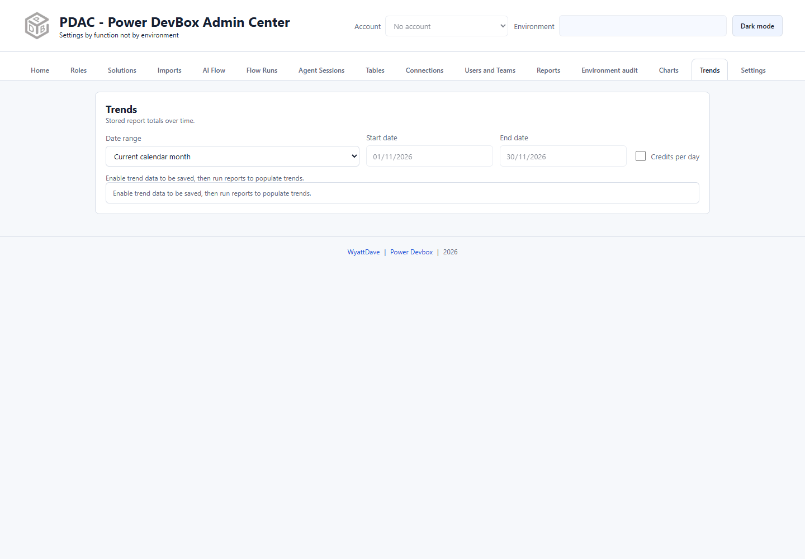

# Trends

Trends displays locally retained report totals over time. PDAC keeps up to **two years** of this history in the extension's IndexedDB storage.

## Start collecting history

1. Open **Reports** and enable **Enable trend data to be saved**.
2. Select report environments and run reports manually, or enable [daily scheduling](reports/scheduling.md).
3. Wait for completed reports, then open **Trends**.
4. Choose the range and check the displayed bounds.

Enabling the switch does not magically recreate every previously missed historical run. Event/session/run reports can reconstruct completed-day snapshots from available timestamped source data; actual coverage still depends on source availability and the runs you collect.

## Date ranges and date basis

The initial view is the current calendar month. Other presets include Today, Last 7/28/365 days, Last 2 years, previous-calendar-month options, a three-calendar-month view, and Custom range.

In **Settings → Trend data**, **Use data date instead of run date** changes which date is used to place rows on charts. It does not change numeric totals. Missing source dates use the day before the run date. Note the chosen basis before comparing exported data or another PDAC installation.

## Daily credits and forecasts

Use **Credits per day** where applicable to inspect daily usage rather than only cumulative totals. Usage forecasts extend the observed day-of-week pattern through the relevant month end; they are projections, not guaranteed consumption or billing statements.

Interpret missing/unknown days separately from known zero usage. Monthly resets, incomplete history, and different collection windows can affect the apparent pattern. Compare like-for-like report filters, environments, date basis, and source periods.

## Explore records

Eligible solution/component/session bars support double-click record lists, with search and pagination. AI-event and flow-run bars do not. Older totals may not have matching daily record inventories, and session lists rely on records still available in Dataverse. See [Charts](charts.md) for those boundaries.

## Keep or move your history

Use [Manage trend data](settings/trend-data.md) to export the combined workbook, download an individual store, import a supported workbook, or clear local totals. Trend workbooks transfer totals, not Microsoft credentials, schedules, weekly event stores, or chart-record inventories.


Trend history is local to this browser profile and extension installation. Export it before removing the extension or clearing its storage. It does not automatically synchronize through your Microsoft account.

