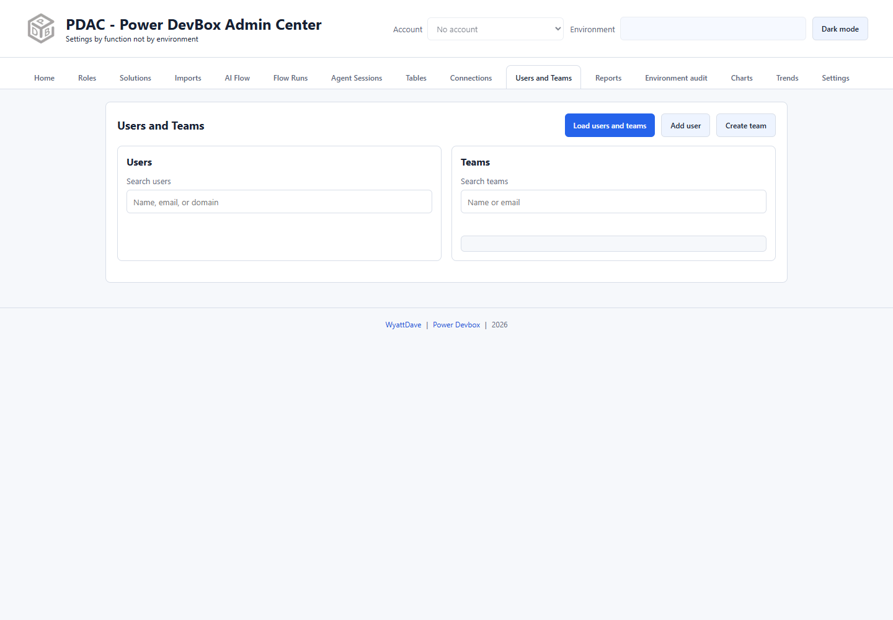
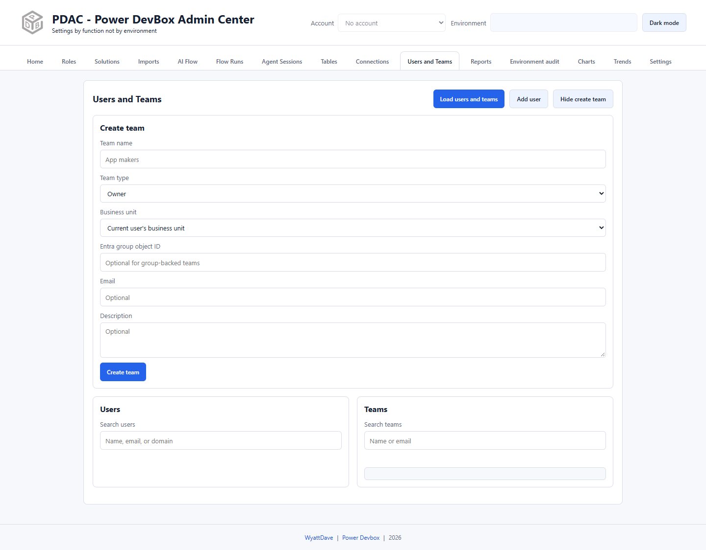

# Users and Teams

Use this section to browse Dataverse principals, sync an existing Entra user, create teams, add members, and manage direct security-role assignments.

## Browse users and teams

1. Choose the correct header account and environment.
2. Select **Load users and teams**.
3. Search users by name, email, or domain; search teams by name or email.
4. Use the list's paging/load-more controls when further results are available. Do not assume the first page is the full inventory.
5. Select a team to inspect membership and member actions.

## Add an existing user

Select **Add user**, enter the **Entra user object ID**, then submit **Add user** in the form. This requests a Dataverse force-sync; it does not create a Microsoft Entra identity or assign a license. The user must already exist and meet sign-in, licensing, and environment security-group requirements.

## Create a team

1. Select **Create team**.
2. Enter the team name and select **Owner**, **Access**, **Security Group**, or **Office Group**.
3. Choose the business unit, or retain the current user's business unit where appropriate.
4. Supply the Entra group object ID for a group-backed team and any relevant optional fields.
5. Submit **Create team** and verify the new team in the loaded list.

For membership changes, select the team and use the enabled, loaded users offered by its member controls. Team type and Dataverse rules determine which actions are valid; do not treat an access team as an owner team.

## View, assign, or remove roles

* **Current roles** opens a read-only list of direct roles and business units, including for disabled users and access teams. It does not include user roles inherited through team membership.
* **Assign role** opens the editable dialog for eligible users/teams. Search roles, review **Current roles** and **Available roles**, and select the intended action.
* Current roles in the editable dialog offer **Remove role**. Selecting an assignment/removal action changes the real association; the read-only Current roles view is safer for inspection.

When you select a root role, PDAC finds the appropriate inherited role copy for the principal's business unit. Disabled users and access teams are not offered the normal editable assignment workflow.


Role removal can remove application or administration access. Direct assignments alone do not describe a user's effective access through teams, groups, ownership, or other privileges. Review the principal and business unit before changing anything.

