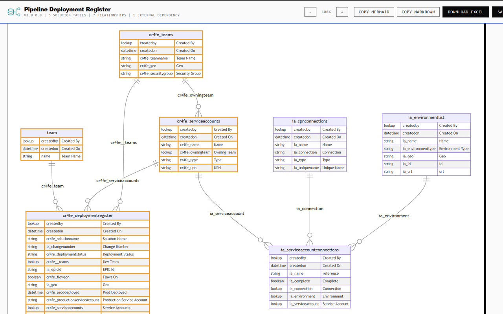

# Power DevBox Dataverse ERD

Power DevBox Dataverse ERD is a Chrome and Microsoft Edge extension that turns a Microsoft Dataverse solution into an **entity-relationship diagram (ERD)** and a table-design document. Use it to understand custom lookup relationships, identify related tables outside your solution, and prepare technical documentation without exporting a solution ZIP.

[Install for Chrome](https://chromewebstore.google.com/detail/power-devbox-dataverse-er/mffdldfcdccomfdofoohglofiemgbpkh) · [Install for Edge](https://microsoftedge.microsoft.com/addons/detail/power-devbox-dataverse-er/jgfjhddjjidpnmmpbnahdjmelfooendd) · [Source code](https://github.com/wyattdave/Power-DevBox-Datverse-ERD)

*Diagram screenshot from the extension's Chrome Web Store listing. The example contains six solution tables, seven relationships and one external dependency; your results depend on your solution.*

## What you can do

| Feature | Use it to |
| --- | --- |
| [Create a diagram](getting-started.md) | Choose a visible solution in your signed-in Dataverse environment. |
| [Read the ERD](diagram.md) | Follow custom lookup relationships and distinguish solution tables from external dependencies. |
| [Copy Mermaid](diagram.md#mermaid-source) | Reuse the diagram's text definition in a Mermaid-compatible documentation tool. |
| [Copy Markdown](exports.md#copy-markdown) | Paste a field catalogue into a Markdown document. |
| [Download Excel](exports.md#table-design-excel) | Review table and column descriptions, lookup targets and choice details in a filterable worksheet. |
| [Save SVG or PNG](exports.md#diagram-images) | Include a diagram in a design document or presentation. |
| [Export role permissions](security-roles.md) | Review table privileges for security roles included in the selected solution. |

## How it connects

The extension uses the authorization token from your existing signed-in Power Platform or Dynamics browser session. It reads Dataverse metadata directly and renders the diagram and exports in your browser. You do not enter a password, paste a token or configure a separate backend.

You still need access to the environment and permission to read the relevant metadata. See [Permissions and data handling](permissions-and-data.md) before installing on a managed device.


**A focused view, not a complete schema audit.** The diagram shows custom lookup relationships, not every standard relationship or many-to-many relationship. The field catalogue is also scoped, rather than a dump of every system column. Read [Diagram and Mermaid](diagram.md) and [Exports](exports.md) for the exact coverage.


## Start here

1. [Install the extension and create your first diagram](getting-started.md).
2. [Understand the diagram and external dependencies](diagram.md).
3. [Export the diagram and table design](exports.md).

This guide describes the public source's **1.0.0** implementation. Store releases may differ. Screenshots are genuine published store images, not reconstructed interfaces.
