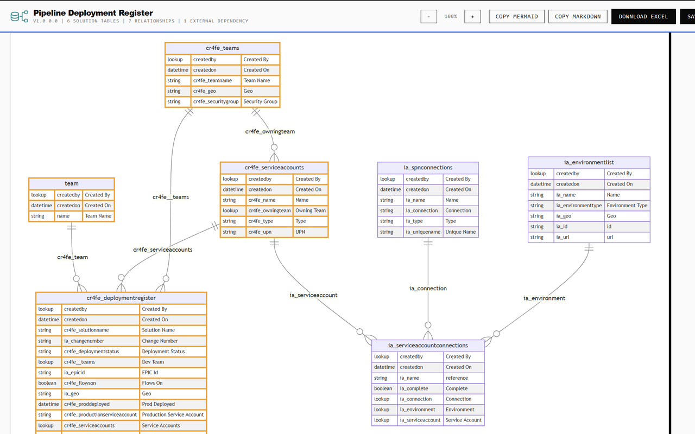

# Diagram and Mermaid

Use the ERD to trace custom lookup relationships around the tables included in your selected solution.

*Published store example. The toolbar continues beyond the right edge of this screenshot; the current viewer also provides image export controls.*

## Read a table

Each table box uses its **logical name**, such as `cr4fe_deploymentregister`. Within the box, a row shows the simplified data type, column logical name and display label.

The diagram includes custom columns plus selected standard columns: the primary-name column, `name`, `createdby` and `createdon`, where present. It is not a complete list of every system column. Intersect tables are excluded from the initial solution-table list.

Types are simplified for Mermaid: lookups become `lookup`, numeric types become `number`, dates become `datetime`, booleans become `boolean`, and other types are represented as `string`. A `string` in the ERD therefore does not necessarily mean the Dataverse column is Text. Use the [table-design export](exports.md#table-design-excel) for more specific types.

## Follow a relationship

Connectors are labelled with the **referencing lookup column's logical name**. Follow the line from that lookup's table to the table it references.

The source renders a one-to-many Mermaid connector: one referenced parent to zero or more referencing children. This is a consistent diagram notation, not a validation of every lookup's requiredness or all Dataverse cardinality rules.

### Which relationships are included?

The extension queries direct many-to-one and one-to-many lookup metadata for solution tables, deduplicates the results, then keeps relationships backed by a **custom Lookup, Customer or Owner column** on the referencing table.

This means:

* A custom lookup can bring in a related table that is not part of the selected solution.
* A standard lookup relationship can be absent even when its tables are visible.
* `createdby` may appear as a column, but its audit relationship to a user or team is excluded.
* Many-to-many relationships are not queried by this diagram.
* Expansion is around the selected solution tables, not a recursive walk of every relationship in the environment.

Do not use the connector count as the total number of relationships defined in Dataverse.

## External dependencies

Related tables outside the selected solution are marked as external dependencies and highlighted in orange. The viewer also displays an external-dependency legend and count when applicable.

Here, **external** means outside the solution's table set—not outside Dataverse, a virtual-table designation, or a claim that data is sent to an external service. A table can exist in the same environment and still be external to this solution.

Use these nodes to discuss solution boundaries and related-table dependencies. The diagram itself does not add a table to the solution or change its dependencies.

## Zoom and navigate

Use **+** and **−** in the viewer toolbar. Zoom changes in 25-percentage-point steps between **25% and 400%**, starting at 100%. Scroll to inspect a diagram larger than the window.

Zoom changes the viewer, not your Dataverse schema. For a large model, [save SVG](exports.md#diagram-images) to inspect it in a scalable format.

## Mermaid source

1. Expand **Mermaid source** below the diagram to inspect its generated `erDiagram` definition.
2. Select **Copy Mermaid** in the toolbar to copy the full definition.
3. Paste it into a tool that supports Mermaid ER diagrams. If the destination expects a code block, put the copied definition inside a Mermaid code block there.

The copied source describes the structure and relationships; the viewer's orange dependency highlighting is applied separately and should not be assumed to carry over to another Mermaid renderer.

There is no in-viewer schema editor or manual diagram-save project. Editing the copied text in another tool does not update Dataverse. To regenerate from newer metadata, reopen the extension on the intended environment and create the diagram again.
