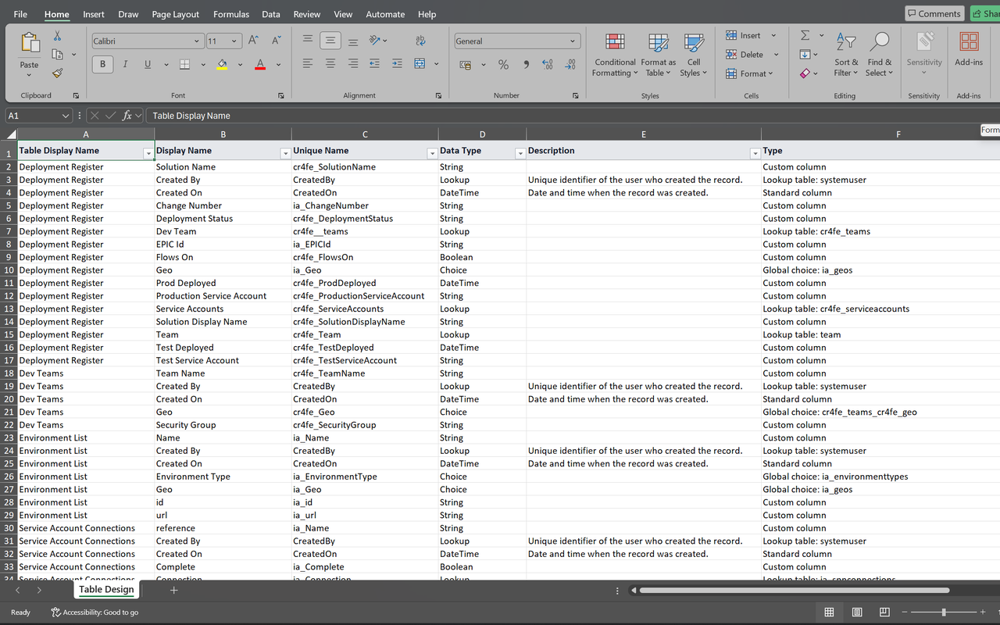

# Exports

Use the viewer toolbar to take the diagram and field catalogue into your documentation workflow. Exports are generated in the browser; they are snapshots of the metadata loaded for that viewer session.

| Button | Result | Best for |
| --- | --- | --- |
| **Copy Mermaid** | Diagram definition on the clipboard | Editable text-based diagrams. |
| **Copy Markdown** | Field-catalogue table on the clipboard | Markdown documentation and wikis. |
| **Download Excel** | Table-design `.xlsx` workbook | Reviewing and filtering column documentation. |
| **Save SVG** | Vector `.svg` diagram | Scalable technical drawings. |
| **Save PNG** | High-resolution `.png` diagram | Documents, slides and image-only destinations. |
| **Role Excel** / **Roles Excel (n)** | Role-permissions `.xlsx` workbook | Reviewing privileges for roles in the solution. |

The role button is conditional; see [Security role permissions](security-roles.md).

## Table-design Excel

1. [Generate a diagram](getting-started.md) and wait for column details to finish loading.
2. Select **Download Excel**.
3. Open the downloaded workbook and select the **Table Design** worksheet.
4. Use the header filters to focus on a table, data type or column classification. The header row is frozen.

*Genuine Excel export screenshot from the extension's Chrome Web Store listing. This contains schema documentation, not business-record values.*

### Worksheet columns

| Column | Contents |
| --- | --- |
| **Table Display Name** | Display name of the column's table. |
| **Display Name** | Human-readable column label. |
| **Unique Name** | Column schema name, falling back to its logical name. |
| **Data Type** | Dataverse type, with `Picklist` shown as `Choice` and `MultiSelectPicklist` as `Choices`. |
| **Description** | Metadata description, when one is defined. |
| **Type** | Lookup targets, choice information, or classification as a custom or standard column. |

For a lookup, **Type** lists target table logical names. For a global choice it records the choice-set name; for a local choice it lists option labels and numeric values when available. Global-choice options are not expanded into that cell. Missing optional details can be reported as unavailable.

### Export scope

The table design covers **solution tables**, not the external dependency tables added to the diagram. It includes custom columns and the selected standard columns described in [Diagram and Mermaid](diagram.md#read-a-table). Auxiliary attributes with `AttributeOf` metadata are excluded.

The result is a practical field catalogue, not a complete schema backup. It does not export business records, all system columns, every validation setting, or a deployable solution package. Blank descriptions mean no description was returned; the extension does not write one for you.

## Copy Markdown

1. Wait until **Copy Markdown** is enabled.
2. Select it and look for **Fields copied as markdown.**
3. Paste into your Markdown editor, wiki or repository document.
4. Add your own document title, solution version, capture date and design notes.

The clipboard contains a table with the same six columns and scoped rows as the table-design workbook. It does **not** contain the diagram or the role-permissions report. Use **Copy Mermaid** or an image export separately for the ERD.

If copying fails, keep the viewer active and try again. You can also use the Excel download for table data or copy text from the expanded **Mermaid source** section for the diagram.

## Diagram images

### Save SVG

Select **Save SVG** to download the rendered diagram as a vector image. SVG is usually the best option for a large model because it remains sharp when enlarged. Check that your target documentation tool accepts SVG; some restrict it for security reasons.

### Save PNG

Select **Save PNG** to download a raster image. The implementation renders it at **four times the base diagram dimensions** with a white background. Viewer zoom is not the PNG resolution setting.

Very large diagrams can exceed browser canvas or memory limits. If PNG export fails, use SVG rather than repeatedly exporting the same oversized image.

### File names

Names use the solution unique name, or friendly name as a fallback, followed by `-diagram`. Characters unsuitable for the generated name are replaced or removed.

For example, a solution with unique name `ContosoProjects` produces:

* `ContosoProjects-diagram.svg`
* `ContosoProjects-diagram.png`
* `ContosoProjects-diagram-table-design.xlsx`
* `ContosoProjects-diagram-role-permissions.xlsx`, when exported.

## Suggested documentation workflow

1. Confirm the environment and solution version before generating.
2. Save SVG or PNG as the visual overview.
3. Copy Markdown for the field catalogue, or attach the Excel workbook.
4. Add the [role workbook](security-roles.md) if security review is in scope.
5. Record capture date and known scope limits alongside the files.
6. Review the exports for sensitive schema details before sharing them.

To refresh the documentation after a schema change, generate a new viewer session and replace the previous snapshots deliberately. There is no automatic version comparison or synchronization of an existing document.
