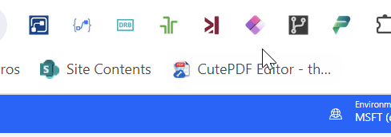

# Exception

<figure><figcaption></figcaption></figure>


Docs updated to match version 1.1.0, if running on older version the Advance mode will not be visible and UI will be different.



All containers on the flow will be used to catch error messages using the result() expression.

```
result('container_name')
```

A container is an action that contains other actions:

* Scope
* Condition
* Switch
* Apply to Each
* Do Until

### How to use&#x20;

To create the exception expression click on the Power DevBox Exception

<figure><figcaption><p>A egg timer will show while generating the expression</p></figcaption></figure>

A popup will show when complete, listing all the containers included in the exception message.

<figure><figcaption></figcaption></figure>

The exception expression is then added to your computers clipboard ready to be pasted (Ctrl + V) where required.

As an example, from the above image the below expression is created.

```
@{xpath(
    xml(
        json(
            concat(
                '{"data": {'
            ,
                '"Scope":'
            ,
                result('Scope')
            ,
                ','
            ,
                '}}'
            )
        )
    )
,
    'string(//message[
       not(
            contains(.,''The execution of template action''))
       and not(
           contains(.,''skipped:''))  
       and not(
           contains(.,''An action failed. No dependent actions succeeded.'')
       )
   ])'
)}
```

Once pasted in an action is should appear as below.

<figure><figcaption><p>pasted in a Outlook exception email</p></figcaption></figure>

#### Additional Information

* The flow must be saved/published before use
* Containers with the word 'Exception' in the title are skipped, this is to avoid self referencing errors
* If the expression is not show, open expression editor, paste in and then remove leading @{ and trailing }
* Power DevBox Exception is used within the Power Automate maker studio (currently does not support Power Apps maker studio
* Certain nested containers can cause issues when saving, as Power Automate will not allow it. To rectify either remove the action from the expression, or temporally rename the container to "Exception", re-run Power DevBox Exception, paste in the expression, then change the name back

### Advanced Mode

Select actions do not pass error messages to the container (example Dataverse actions). This requires the action to be referenced directly with both actions() and outputs() expression.

```
actions('action_name')
outputs('action_name')
```

New Mode will automatically add all API actions (actions not built in) to the expression

<figure><figcaption></figcaption></figure>


As an example, from the above image the below expression is created.

```
@{xpath(
    xml(
        json(
            concat(
                '{"data": {'
            ,
                '"Scope":'
            ,
                result('Scope')
            ,
                ','
            ,
                '"Update_a_row_date":'
            ,
                actions('Update_a_row_date')
            ,
                ','
            ,
                '"Update_a_row_date-O":'
            ,
                outputs('Update_a_row_date')
            ,
                ','
            ,
                '"Get_file_content_using_path_words":'
            ,
                actions('Get_file_content_using_path_words')
            ,
                ','
            ,
                '"Get_file_content_using_path_words-O":'
            ,
                outputs('Get_file_content_using_path_words')
            ,
                ','
            ,
                '}}'
            )
        )
    )
,
    'string(//message[
        not(
            contains(.,''The execution of template action''))
        and not(
            contains(.,''skipped:''))  
        and not(
            contains(.,''An action failed. No dependent actions succeeded.'')
        )
    ])'
)}
```

To Activate Advanced Mode press Ctrl+m

<figure><figcaption></figcaption></figure>

#### Additional Information

To stop self referencing actions any action that will have the expression as an input must have the word 'exception' in the name.

### Run Log Url

Press ctrl + e adds the following expression to your clipboard ready to paste.

```
@{concat(
    'https://make.powerautomate.com/manage/environments/'
, workflow()?['tags']?['environmentName'], '/flows/', workflow()?['name'], '/runs/', workflow()?['run']['name'])}
```

When added to a flow it returns a link to the run, idea for a exception notification, allowing quick link to the run.

<figure><figcaption></figcaption></figure>

