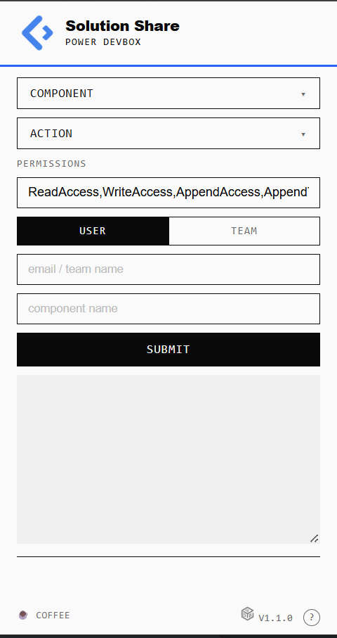

# Share


<figure><figcaption></figcaption></figure>

If the Power DevBox Share icon is red then it has not connected to the Power Platform.


<figure><figcaption></figcaption></figure>

Refresh the page and the icon should lose the red background.

<figure><figcaption></figcaption></figure>

Clicking on the icon will open the menu.

<figure><figcaption></figcaption></figure>

### Inputs

There are 6 inputs for Power DevBox Share

* Components
* Action
* Share Permissions
* Share Type
* Share To
* Component

#### Components

<figure><figcaption></figcaption></figure>

Currently only Environment Variables, Connection References, Custom Connectors, Flows, and AI models are supported.

Solution Contents will share all of the above that are in the selected solution

#### Action

<figure><figcaption></figcaption></figure>

You can Share the component/solution, Change Owner, or Stop Sharing.

#### Share Permissions

Sharing Permissions is only for sharing, not for change owner or Stop Sharing. There are the following permissions, that can be used individually or stacked with commas

* ReadAccess
* WriteAccess
* AppendAccess
* AppendToAccess
* CreateAccess
* DeleteAccess
* ShareAccess
* AssignAccess

#### Share Type

<figure><figcaption></figcaption></figure>

There are 2 share types, user or team. Both required to be added to the relevant table before (systemusers/teams).

#### Share To

<figure><figcaption></figcaption></figure>

To share with a user use their upn (user principle name) email address. For teams the team name from the teams table is required.

#### Component Name

<figure><figcaption></figcaption></figure>

This is the component or solution you wish to share/change owner/stop sharing. It is not the display name but the unique name, this can be found here:

**Solution** -  e.g. CustomForm

<figure><figcaption></figcaption></figure>

<figure><figcaption></figcaption></figure>

**Connection Reference** - e.g. wd\_OutlookcustomForm

<figure><figcaption></figcaption></figure>

**Environment Variable** - e.g. wd\_customFormsite

<figure><figcaption></figcaption></figure>


**Custom Connector** - e.g. wd\_5Fautoreview

<figure><figcaption></figcaption></figure>

**Flow** - e.g. Send Form

<figure><figcaption></figcaption></figure>

### Outputs

<figure><figcaption></figcaption></figure>

After pressing Submit Power DevBox Share will update the required components, there are multiple steps to each:


* Find Share To
* Find Solution\*
* Find Component
* Share/Change Owner/Stop Sharing

The outputs from these steps will show in the output box. This will be a mix of 200 and 204


#### Example response

```
// Some code200
200
200
Finding User

Finding User

Finding User

Finding User

Finding User

Finding User

Finding User

Finding User

200
Updating component 1 of 8

Sharing Component

200
Updating component 2 of 8

Sharing Component

200
Updating component 3 of 8

Sharing Component

200
Updating component 4 of 8

Sharing Component

200
Updating component 5 of 8

Sharing Component

204
""
204
204
""
204
204
200
""
""
""

Updating component 6 of 8

Sharing Component

200
Updating component 7 of 8

Sharing Component

200
Updating component 8 of 8

Sharing Component

204
204
""

""

204
8 components in total, 8 updated, 0 not compatible

""
```

The api calls are in parallel so the order may not be correct as its due on when the response replied.

####

#### Errors

Errors will be shown in the response.

<figure><figcaption></figcaption></figure>
