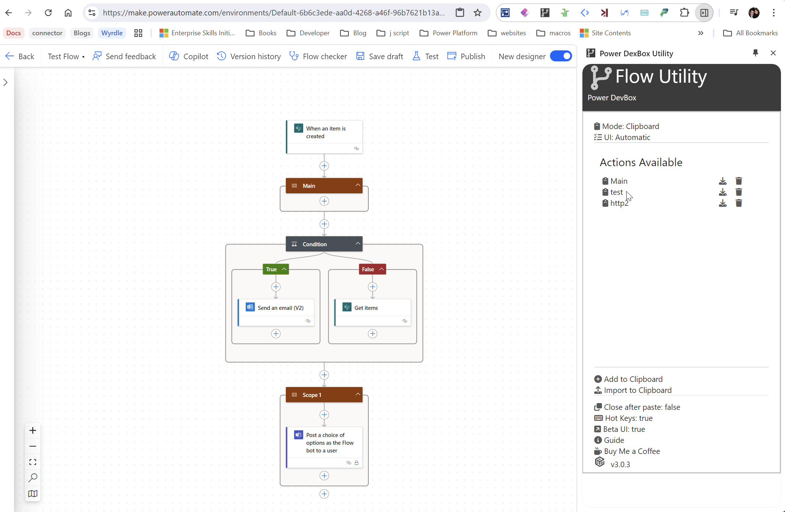

---
layout:
  width: default
  title:
    visible: true
  description:
    visible: true
  tableOfContents:
    visible: true
  outline:
    visible: true
  pagination:
    visible: false
  metadata:
    visible: true
  tags:
    visible: true
  actions:
    visible: true
  anchors:
    visible: true
---

# Utility Demo Videos

<figure><figcaption>
Add to Flow New UI
</figcaption></figure>

<figure><figcaption>
Add to Flow Classic UI
</figcaption></figure>
