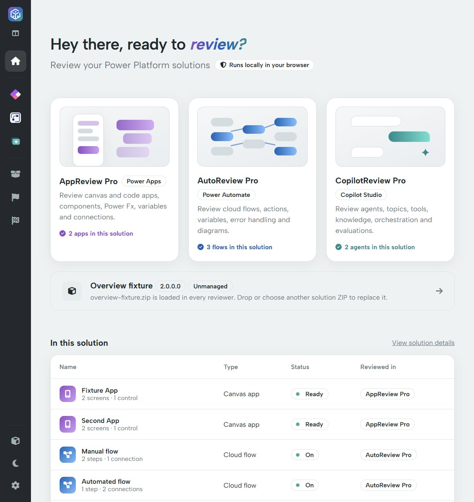

# Power DevBox Review

Power DevBox Review brings **AppReview Pro**, **AutoReview Pro** and **CopilotReview Pro** into one browser workspace. Load a Power Platform solution ZIP once, then review its apps, cloud flows, agents and shared solution components without switching tools or uploading the solution to a server.

[Open Power DevBox Review](https://review.powerdevbox.com/) · [Start your first review](getting-started.md) · [Download custom-flag authoring skills](flags/custom-flags/ai-skills.md)

## What you can review

| Section | Use it to |
| --- | --- |
| [Home](home.md) | Load a solution and see which apps, flows and agents it contains. |
| [AppReview Pro](appreview-pro/README.md) | Inspect app components, Power Fx, variables, data connections, tests and diagrams. |
| [AutoReview Pro](autoreview-pro/README.md) | Inspect flow triggers, actions, variables, exception handling and diagrams. |
| [CopilotReview Pro](copilotreview-pro/README.md) | Inspect agent instructions, topics, skills, tools, knowledge and evaluations. |
| [Solution](solution/README.md) | Browse shared metadata, component inventories and the exported package files. |
| [Flag report](flags/flag-report.md) | Review custom-rule findings from all four data sections in one place. |
| [Custom flags](flags/custom-flags/README.md) | Maintain your own review standards as reusable JavaScript rules. |
| [Settings](settings.md) | Manage Pro activation, reviewer preferences, installation and local bug reports. |

## Free review and Pro features

Standard reviews, solution browsing and standard exports need **no account or license key**. **Custom flags**—including their execution and reports—and **comparison of two solution versions** require a validated **Power DevBox Pro** license. A reviewer name ending in “Pro” does not mean its standard review is locked.

## About this guide

This guide describes the combined workspace, version **0.2.0**, checked against the source on 13 November 2026. The older [AppReview Pro](../appreview-pro/README.md) and [AutoReview Pro](../autoreview-pro/README.md) spaces describe the standalone tools; their upload, license and custom-flag instructions can differ.

Screenshots show the real local application with **synthetic test exports**. Custom-flag and comparison screenshots use the application's mocked test-license responses; they do not show a real customer activation. Empty fields and zero counts reflect the deliberately small example, not a requirement for your solution.

Start with [Getting started](getting-started.md), or go directly to the reviewer you need.
