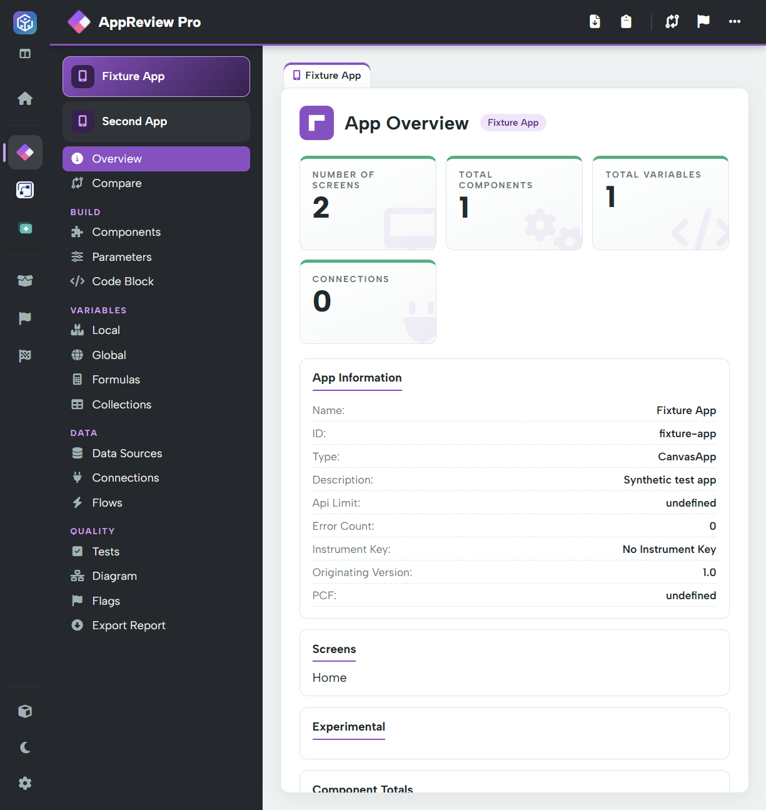

# App overview

AppReview Pro reviews the apps found in the loaded solution. Its canvas-app views expose Power Fx, controls, variables and data references. Available detail depends on the app type and what the export contains.

1. Load a solution and open **AppReview Pro**.
2. If more than one app is listed, select the app to review.
3. Start at **Overview**, then use the Build, Variables, Data and Quality menu groups.

## Overview

The cards summarise screens, components, variables and connections. App Information includes the name, ID, type, description and available configuration such as API limit, app-checker error count, instrumentation and originating version. Further panels list screens and component totals.

Use this view to confirm you are reviewing the right app and identify areas needing deeper inspection. A high component count is a prompt to investigate, not an automatic defect. A blank or `undefined` value means the field was not supplied or resolved in this export; do not treat it as a measured runtime value.

## Review sequence

* [Components, Parameters and Code Block](build.md): understand structure and formulas.
* [Local, Global, Formulas, Collections and data](variables-and-data.md): review state and dependencies.
* [Tests, Diagram and Flags](quality.md): examine quality evidence.
* [Compare](../comparing-versions.md): inspect differences against an older export.
* [Export Report](../navigation-and-exports.md#exports): save a readable review, with separate exports for code and parameters if required.

The workspace owns solution files, licensing and the custom-rule library. Use **Solution** and **Settings** in the outer sidebar instead of following standalone AppReview upload/settings instructions.
