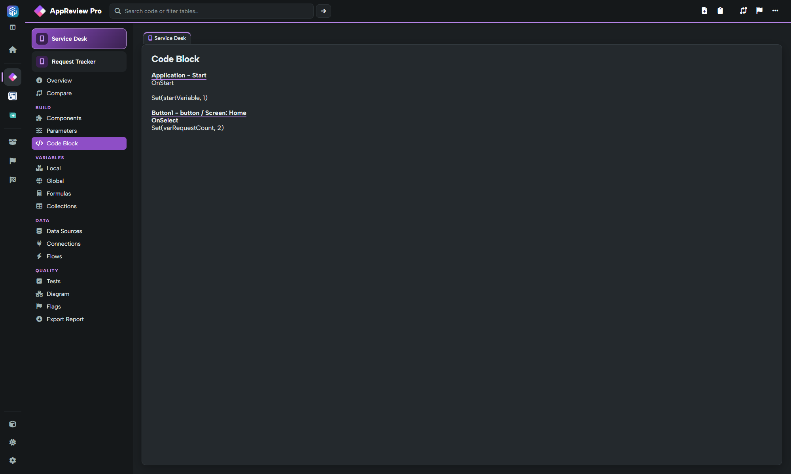

# Components, parameters and code

These Build views help you move from app structure to the formulas responsible for behaviour.

## Components

Open **Components** to inspect the app's control/component inventory. Use names, types and screen context to locate an element before inspecting its formulas. Totals help identify heavily populated screens and repeated control types.

Check whether names explain purpose and whether repeated structures could be simplified. Controls that look identical can still have different formulas; use Parameters rather than relying only on the inventory.

## Parameters

**Parameters** shows control properties with their screen, control name, type, parameter/property and code. A control normally has multiple property rows. For example, `Button1.Text` and `Button1.OnSelect` are different records, not duplicate controls.

Use the header filter when available to narrow to a control name or property. Review behavioural formulas and important visual/accessibility properties in context. An absent property can mean the app uses a default; absence alone does not prove a configuration error.

## Code Block

**Code Block** presents extracted formulas as a readable source view. Search for a control, variable, function or reference, then read the surrounding formula before deciding whether it is a problem.

In **Settings → Reviewer preferences**, AppReview's **Code Block only 'On' parameters** setting controls whether that view is restricted to event-style properties. Turn it off when your review also needs non-event formulas. The Parameters view and raw downloaded data help verify that a search did not miss content because of a display preference.

## Suggested checks

* Look for repeated queries and hard-coded environment-specific references.
* Check error handling around operations that can fail.
* Review work performed at startup and on screen visibility.
* Trace state changes rather than assuming every text match is an executable reference.

Static extraction and text matching are not Monitor traces, delegation analysis or a performance benchmark. Test important conclusions in the app. Use the header to export/copy the current view; the full **Export Report** deliberately excludes Code Block and Parameters.
