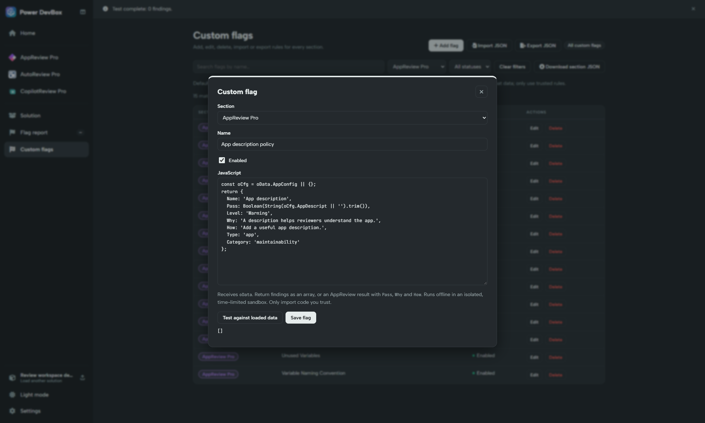

# Tests, diagram and flags

## Tests

Open **Tests** to inspect test suites and test cases included in the app export. Review their names, descriptions and actions. Look for coverage of important user journeys, validation and error cases.

These are **test definitions**, not evidence that tests were executed or passed. A missing test definition means none was found in the exported data; it is not a complete assessment of your team's external test coverage.

## Diagram

**Diagram** provides the app diagram generated by the reviewer. Use it to orient yourself around the extracted app structure and inspect relationships alongside the corresponding code. Where shown, header zoom controls make a large diagram easier to read.

A generated diagram is not a screenshot of the rendered app and is not a complete runtime trace. Verify behaviour in the source and in normal app testing.

## Flags


**Power DevBox Pro required for custom flags:** creating, testing, running and reporting custom rules needs an activated license. [Buy Power DevBox Pro](https://power-devbox.lemonsqueezy.com/checkout/buy/729d48f6-cc59-477e-a601-ca99100ffeb3). Standard app/checker review remains free.


AppReview retains its native app-review/checker information. The combined workspace also provides a separate, Pro-gated **Custom flag report** in the header. That report is scoped to the selected app; **All flags** takes you to the cross-solution custom-flag report.

Do not equate “no custom findings” with a clean app. Disabled rules, absent data, an unrun scan or a rule execution error can all leave no findings. Check scan status and errors first. See [Flag report](../flags/flag-report.md).

### Create an AppReview custom flag

1. In AppReview's header, choose **More actions → Manage custom flags**. The central library opens with **AppReview Pro** selected.
2. Select **Add flag** and confirm **Section → AppReview Pro**.
3. Enter a name and JavaScript function body using the current app's `oData` fields. AppReview property names are case-sensitive, such as `AppConfig.AppDescript`.
4. Choose **Test against loaded data**. The rule runs independently against every app in the loaded solution.
5. Inspect the findings, select **Save flag**, then **Run all flags** to refresh the report.

The example uses demonstration data and a test license response. `Pass: true` produces no finding, so this description check shows `[]` for the described apps. Use a case with a missing description to check the failure path too. See [Create and test a flag](../flags/custom-flags/create-and-test.md) and the [Apps example rule](../flags/custom-flags/examples.md#apps-missing-description).

## Export Report

Use **Export Report** for the consolidated AppReview report. It excludes **Code Block** and **Parameters**, which can be exported separately from their views. Review the downloaded file for source/configuration details before sharing it. Standard report export is free; custom-flag execution and reporting require Pro.
