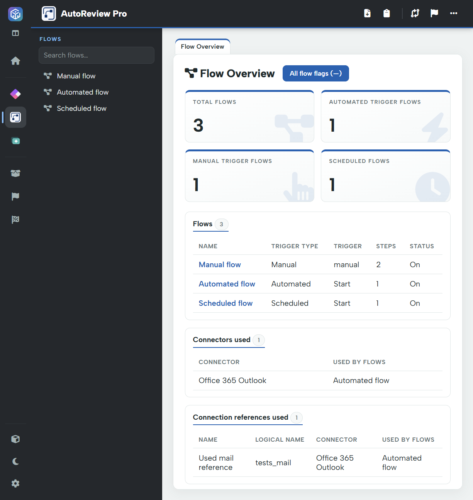

# Flow overview

AutoReview Pro reviews cloud flows in the loaded solution. It starts with **Flow Overview**, then lets you open individual flows for action-level analysis.

## Overview cards and flow list

The cards show total flows and automated, manual and scheduled trigger counts. The flow table lists each flow's name, trigger type, trigger, step count and available status. Select a flow in this table or in the left menu to open its detailed review.

Use **Search flows** to narrow a long menu. Return to the **Flow Overview** tab when you need the cross-flow inventory again.

## Dependencies actually used by flows

The overview lists **Connectors used**, **Connection references used** and **Environment variables used**, with their flow associations. These lists are usage-oriented: unused declarations and unrelated solution components are not included just because they exist in the package.

For the complete shared component inventory, including unused declarations, open **Solution**. This explains why a solution-level count can be larger than the corresponding “used” list in Flow Overview.

## All flow flags

**All flow flags** opens AutoReview's embedded custom report across every flow. A number is shown after a completed scan; a dash is not a finding count. An individual flow's Custom Flags action narrows to that flow. Custom flags require Pro.

Continue with [Flow review and actions](flow-review.md), [Flow diagrams](diagrams.md), or [Compare solution versions](../comparing-versions.md).
