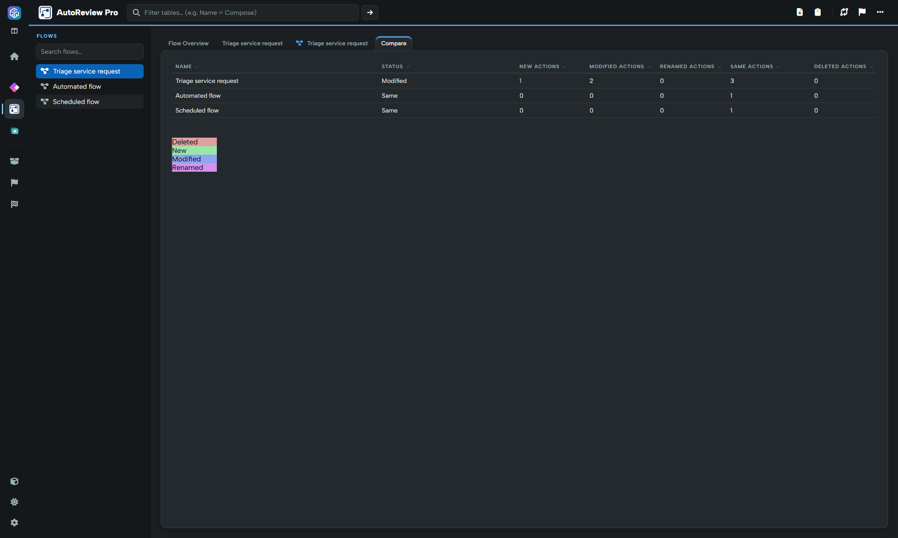
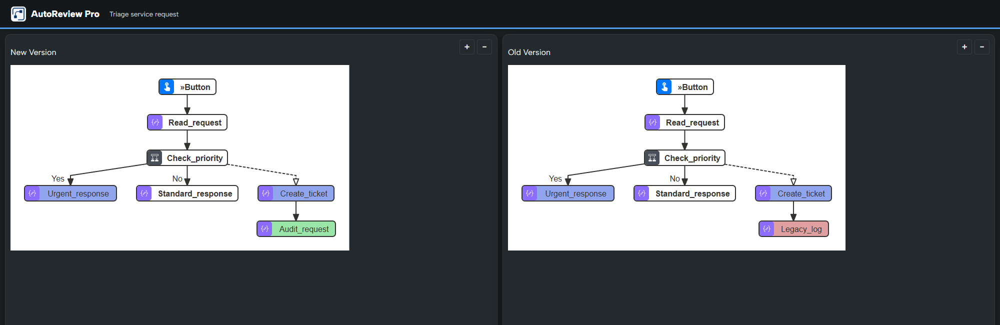

# Compare two flow diagrams

Use AutoReview's side-by-side comparison to see how a flow's structure and actions changed between two solution exports. This differs from opening the ordinary Diagram view for a single loaded flow.


**Power DevBox Pro required for version comparison.** [Buy a license](https://power-devbox.lemonsqueezy.com/checkout/buy/729d48f6-cc59-477e-a601-ca99100ffeb3) and activate or validate it in [Settings](../settings.md). A standard single-version flow diagram remains free.


## Prepare the two versions

1. Load the **newer** solution ZIP from Home.
2. Open **AutoReview Pro** and choose the header **Compare with an older version** action. Alternatively, **Solution → Compare versions** prepares comparison across all three reviewers.
3. Choose an **older** ZIP of the same solution and wait for **Comparison ready**.
4. In AutoReview, open the **Compare** tab.

The flow table summarises matching flows and counts of **New Actions**, **Modified Actions**, **Renamed Actions**, **Same Actions** and **Deleted Actions**. A newly introduced flow can be identified as **New Flow** rather than a matching pair.

## Open the diagram pair

Select the **flow name** in the comparison table. AutoReview opens a new browser tab with two panels:

* **New Version**, on the **left**: the currently loaded flow.
* **Old Version**, on the **right**: the flow from the older comparison export.

The example uses synthetic exports. `Audit_request` exists only in the new version, `Legacy_log` only in the old version, and the urgent-response and ticket actions have changed inputs.

## Read the colours

| Colour | Meaning | Review action |
| --- | --- | --- |
| Green | New action | Check why it was added and how it joins the flow. |
| Red/pink | Deleted action | Confirm that removing the old behaviour is intentional. |
| Blue | Modified action | Inspect the action's inputs and configuration in both versions. |
| Purple | Renamed action | Check the new name and any associated references. |
| Unmarked | No detected action change | Still consider surrounding structural changes. |

Colours describe the comparison result; they are **not severity ratings**. Use the legend in the comparison table if a colour is ambiguous.

## Inspect and navigate

Use the **+ / −** controls in each panel to zoom independently and drag to pan a larger diagram. Select an action node to open its comparison details, then inspect the old and new inputs/settings rather than judging the change from its label alone.

If no new tab opens, check whether the browser blocked the popup. The diagram tab uses comparison data prepared by the workspace in this browser origin. If it says no data is available, return to the workspace, rerun comparison and reopen the flow from the table; a bookmarked diagram URL does not reload the two ZIPs by itself.

Keep the newer ZIP as the loaded baseline. Comparison does not merge definitions, edit a solution or deploy changes. Changes in static definitions do not prove a runtime performance or API-usage improvement.
