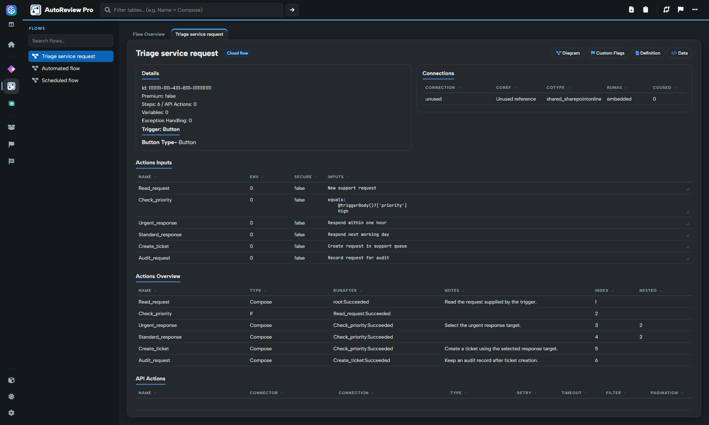

# Flow review and actions

Open **AutoReview Pro**, then choose a flow from Flow Overview or the left menu. The detail view brings together the trigger, connections, variables, exception handling and action inventory.

## Trigger and summary

Confirm the flow identity and inspect the trigger type and available configuration: inputs, conditions, recurrence and connector details vary by trigger. Review counts for connections, actions, API actions, variables and exception-handling actions as a guide to complexity.

A scheduled trigger is not equivalent to an automated connector trigger. Consider how often it can run, what starts it and whether its filtering belongs at the trigger or later in the flow.

## Connections

Review connector/reference names, usage and available run-as information. Confirm that the connection-reference naming and deployment choices follow your team's standards. A reference in an export does not validate the actual connection or its credentials in a target environment.

## Variables

Inspect each variable's name, type, initial value and set/use counts. Investigate unused variables, values that are never set, and state introduced where a direct expression or Compose would be clearer. Reference counts are extracted from the definition; they are not runtime measurements.

## Exceptions

The Exceptions area identifies actions interpreted as failure/exception-handling paths. Review their run-after conditions and whether the intended failure path actually captures the relevant errors. Merely having a scope named Exception does not establish correct error handling.

## Actions Overview and action detail

Use **Actions Overview** to locate an action and inspect its extracted details. Depending on the action, this includes connector/operation, inputs, notes, run-after conditions, secure settings, retries, timeout, pagination and filter information. Use **Review** and **Diagram** links where offered to move between the detailed definition and structural view.

For a practical review, inspect external calls, loops and nested conditions first. Then check filtering/pagination, failure paths, sensitive inputs/outputs and environment-specific values. Source text can be encoded or expression-based; verify a suspicious value in its surrounding definition.

## Custom Flags and preferences


**Power DevBox Pro required for custom flags and their findings.** [Buy a license](https://power-devbox.lemonsqueezy.com/checkout/buy/729d48f6-cc59-477e-a601-ca99100ffeb3) and activate it in Settings. Reading flow definitions and standard diagrams is free.


The flow's **Custom Flags** action opens its scoped findings. It does not open the rule editor. Choose **Manage flags** to change definitions, then rerun the scan.

After loading a solution, **Settings → Reviewer preferences → AutoReview Pro** exposes its available display/export options, including Markdown copying, custom download title and flag highlighting on review/diagrams. Some legacy presentation options are also listed; they do not replace the central custom-rule editor or make manual changes to results into a reusable rule.

Use the header's HTML and copy actions to capture the active view. See [Navigation, filters and exports](../navigation-and-exports.md).
