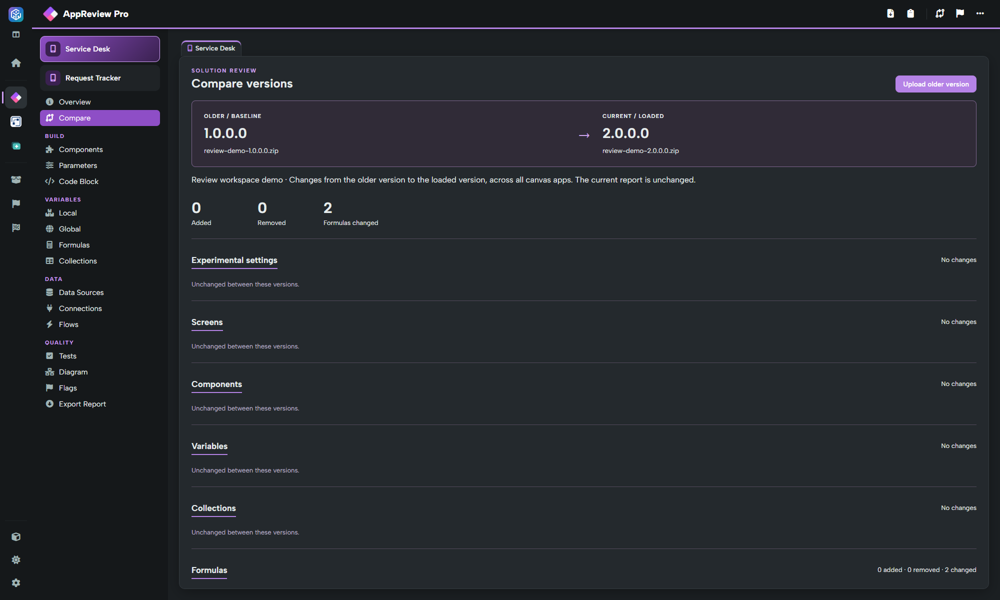
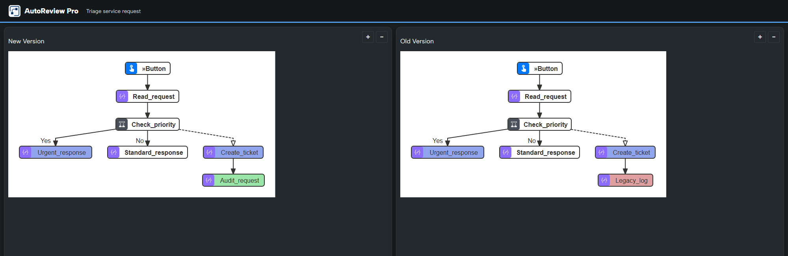
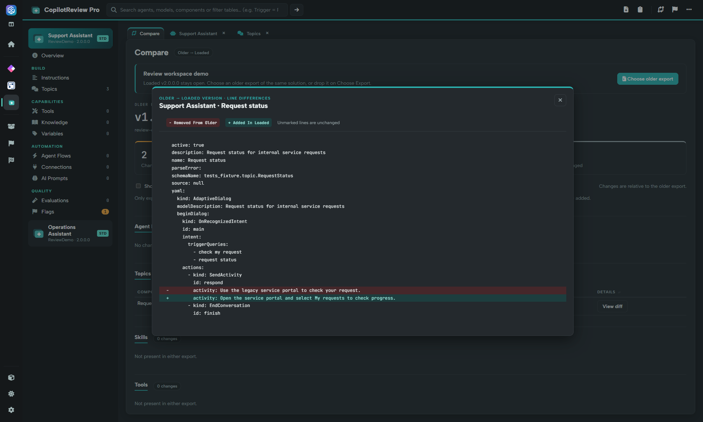

# Compare solution versions

Comparison helps you review changes between two exports of the **same solution**. It requires validated Power DevBox Pro access and both ZIP files on your device.


**Power DevBox Pro required for comparison.** [Buy a license](https://power-devbox.lemonsqueezy.com/checkout/buy/729d48f6-cc59-477e-a601-ca99100ffeb3), then activate or validate it in [Settings](settings.md). Loading and reviewing a single solution remains free.


## Start a comparison

1. Load the **newer** solution through Home.
2. In [Settings](settings.md), activate or validate your Pro key if needed.
3. For a workspace-wide comparison, open **Solution → Compare versions**. To compare in only one reviewer, use that reviewer's header **Compare with an older version** button.
4. Select the **older** solution ZIP.
5. Wait for **Comparison ready**. Open the reviewers' comparison views to inspect the results.

The example uses synthetic exports and a mocked test license. Its small app change is only an illustration of the comparison UI.

## Read the result

* **AppReview** provides its app comparison, including source/configuration differences supported by its engine.
* **AutoReview** provides its flow comparison and changed-flow diagrams.
* **CopilotReview** provides its comparison of agent configuration and components.

## Compare two flow diagrams

AutoReview's comparison lists matching flows and their added, modified, renamed and deleted actions. Select a flow name to open **New Version** and **Old Version** diagrams side by side in a new tab. This is separate from the single-version Diagram action.

Follow [Compare two flow diagrams](autoreview-pro/comparing-diagrams.md) for the full workflow, colour key, zoom controls and action-detail comparison.

## Compare agent topics

In CopilotReview's **Compare** tab, find **Topics** and choose **View diff** for a changed topic. The popup marks lines removed from the older export and lines added in the loaded version.

Follow [Compare topics between solutions](copilotreview-pro/comparing-topics.md) for matching rules, unchanged items and an illustrated walkthrough.

The loaded newer ZIP remains the baseline. Selecting the older file through **Compare** does not replace it. Comparison is a review aid, not a solution merge or deployment tool; it does not update your environment or produce a patched solution.

## Requirements and common errors

The solution's unique name must match, ignoring case. Versions must be numeric, and the comparison version must be strictly older than the loaded baseline. If you select the same or a newer version, load the newest export through Home first, then retry Compare with the older file.

A workspace-wide comparison can report an error from one reviewer while others succeed. Read the banner and inspect the relevant reviewer rather than assuming every comparison completed. Configuration differences in the package do not prove a runtime behaviour change; confirm important changes through normal testing.
