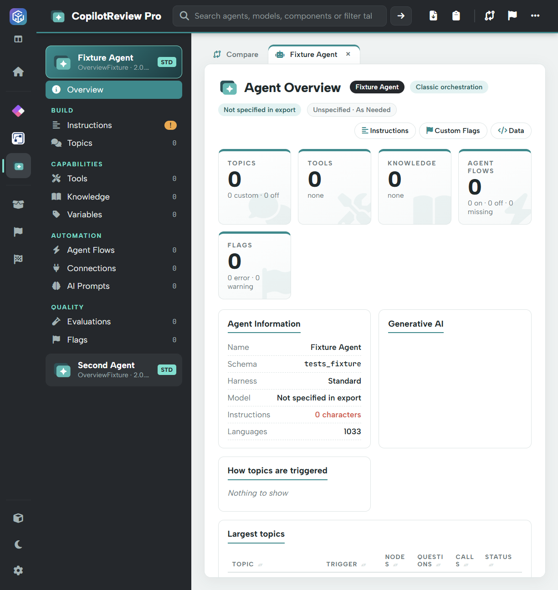

# Agent overview

CopilotReview Pro reviews agent configuration and components from the loaded solution. Select an agent in the left menu to see its own Overview and grouped navigation.

## Overview

The view summarises the agent's identity, available harness/model information, instructions and component counts. It brings together configuration such as orchestration, authentication, generative AI settings, topics, knowledge and linked flows where present in the export.

Start by checking the correct agent and schema name. Investigate missing instructions, broken references and publish diagnostics, then review the capabilities that can read data or take action. “Not specified in export” is not a confirmed live-environment setting.

## Navigation groups

| Group | Views |
| --- | --- |
| Build | [Instructions, Topics and Skills](build.md) |
| Capabilities | [Tools, Knowledge and Variables](capabilities.md) |
| Automation | [Agent Flows, Connections and AI Prompts](automation-and-quality.md) |
| Quality | [Evaluations and Flags](automation-and-quality.md#evaluations) |

Navigation is data-dependent. For example, **Skills** is shown for a GitHub harness or an agent with skills, while Topics can depend on the harness and available topic content. A section can also be present with zero items.

## Open component details

Select the linked name in a table to inspect the component detail. Where available, topic/tool views provide diagrams, YAML or data tabs. These show exported definitions, not live conversations or tool executions.

For shared solution components or raw package files, use **Solution** in the outer sidebar. For the internal actions of linked cloud flows, use **AutoReview Pro**.
