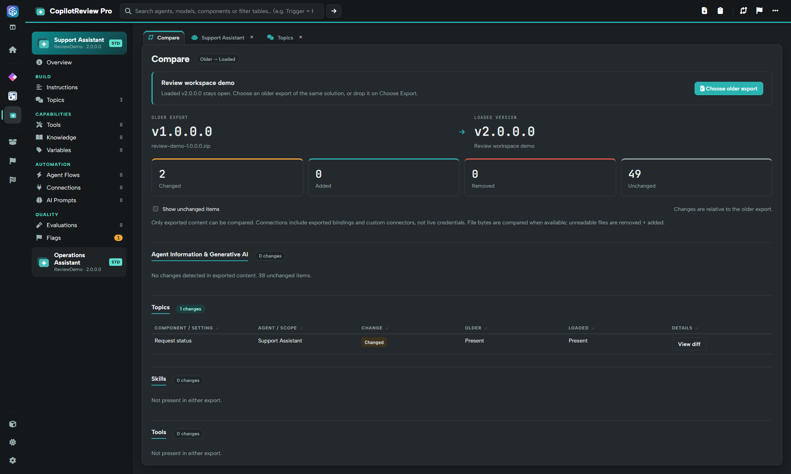
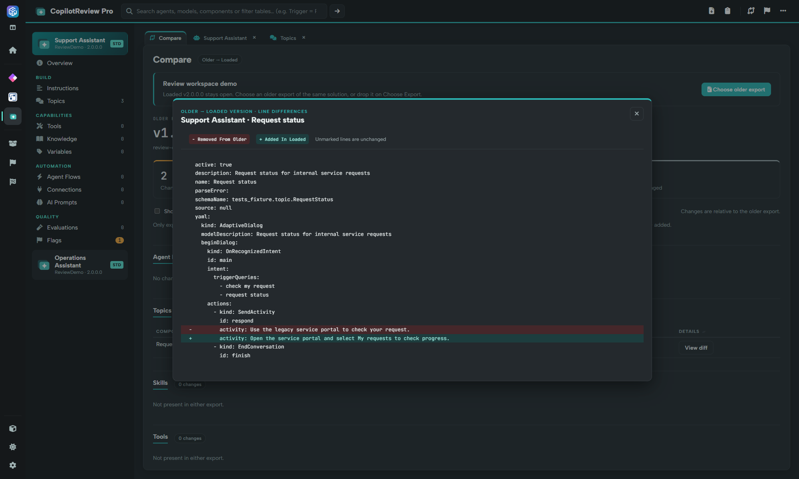

# Compare topics between solutions

CopilotReview compares agent settings and exported components between an older and a loaded solution. Use its **Topics** results to find changes to topic definitions, then open the line-level diff.


**Power DevBox Pro required for comparison.** [Buy a license](https://power-devbox.lemonsqueezy.com/checkout/buy/729d48f6-cc59-477e-a601-ca99100ffeb3) and activate or validate it in [Settings](../settings.md). Inspecting topics in a single solution is free.


## Start with the newer solution

1. Load the **newer** solution ZIP through Home.
2. Open **CopilotReview Pro** and choose the header **Compare with an older version** button, or start a workspace-wide comparison from Solution.
3. Choose an older export of the **same solution** and wait for completion.
4. Open CopilotReview's **Compare** tab and find the **Topics** section.

The comparison shows the older and loaded versions, totals for changed/added/removed/unchanged items and grouped results. Other groups cover agent information, skills, tools, knowledge, agent flows, connections, AI prompts and connection references where present.

## Open a topic diff

Choose **View diff** on a Topics row. The popup identifies the agent and topic and shows line differences in exported content, including topic YAML where available.

* **Removed From Older**, with a minus sign: text present in the older export but not the loaded version.
* **Added In Loaded**, with a plus sign: new text in the loaded version.
* **Unmarked lines**: unchanged context.

In this synthetic example, **Request status** changes its response from a legacy-portal instruction to a clearer **My requests** instruction. The diff exposes the actual wording, not just a “changed topic” count.

Close the popup using **×** or **Escape** to return to the comparison. Enable **Show unchanged items** if you also need unchanged Topics rows; hiding them does not remove them from the comparison totals.

## Interpret the evidence

The loaded newer solution stays open. The comparison does not publish or edit the agent. Components that cannot be reliably matched can appear as removed plus added rather than changed; verify identities before treating that as a deliberate deletion.

Only exported content is compared. Topic-definition changes do not show conversation outcomes or prove that an evaluation passed. Review linked capabilities and run your normal agent tests before approving behavioural changes.
