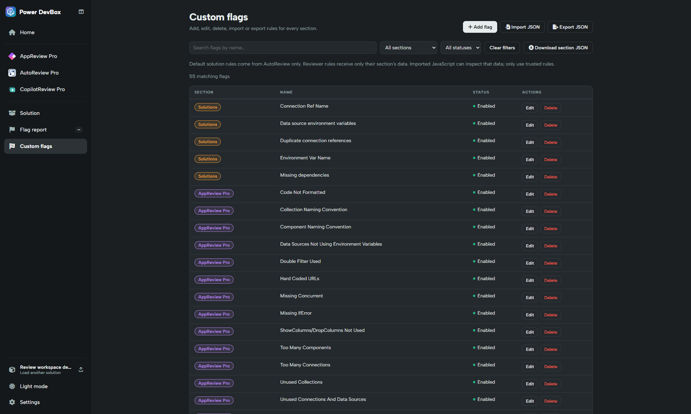

# Custom flags

Custom flags are small JavaScript checks that turn your team's review standards into repeatable findings. A central library serves Apps, Automate, Copilot and Solutions. Managing and executing these rules requires validated Power DevBox Pro access.


**Power DevBox Pro required:** creating, testing, managing, importing/exporting and running custom flags needs a validated license. [Buy Power DevBox Pro](https://power-devbox.lemonsqueezy.com/checkout/buy/729d48f6-cc59-477e-a601-ca99100ffeb3) and activate it in [Settings](../../settings.md).


## Find a rule

Open **Custom flags** from the workspace sidebar, or **More actions → Manage custom flags** inside a reviewer. The latter opens the same library filtered to that reviewer.

Combine **Search flags by name**, section and enabled/disabled status to narrow the list. Name search is case-insensitive. **Clear filters** resets all three controls. The all-section view groups Solutions first, then Apps, Automate and Copilot, sorting names within each group.

## Library actions

* **Add flag:** choose section, name, enabled status and function-body code.
* **Edit:** change a rule or toggle its **Enabled** checkbox, then save.
* **Delete:** remove a rule after confirmation. Export a backup first if needed.
* **Import JSON / Export JSON:** move executable rules between browsers or teams.
* **Download section JSON:** inspect the actual data supplied to a section's checks.

Saving a rule updates browser storage immediately; there is no separate whole-library Save button. Edits, imports and deletions invalidate existing results, so rerun the flags afterward.

## Starter rules and storage

The app seeds its starter library and adds updated defaults without overwriting saved edits or disabled rules. Default solution rules come from AutoReview only. Old unchanged duplicate solution rules from the other packs can be cleaned up by the app's migration; edited/user-created rules are preserved.

Your library is stored for this **browser origin**. Another browser/profile or the old standalone reviewer sites will not automatically share it. Export your rules before clearing site data or moving to a new origin.

## Build your own standard

1. [Choose the input scope and output contract](data-and-output.md).
2. [Create and test a rule](create-and-test.md).
3. [Try the examples](examples.md).
4. [Download the AI authoring skills](ai-skills.md) if you want assistance writing checks.
5. [Import/export safely](import-export.md) and review the [combined report](../flag-report.md).

Only import code you trust. Sandbox isolation reduces access, but does not make arbitrary JavaScript harmless or establish that its findings are correct.
