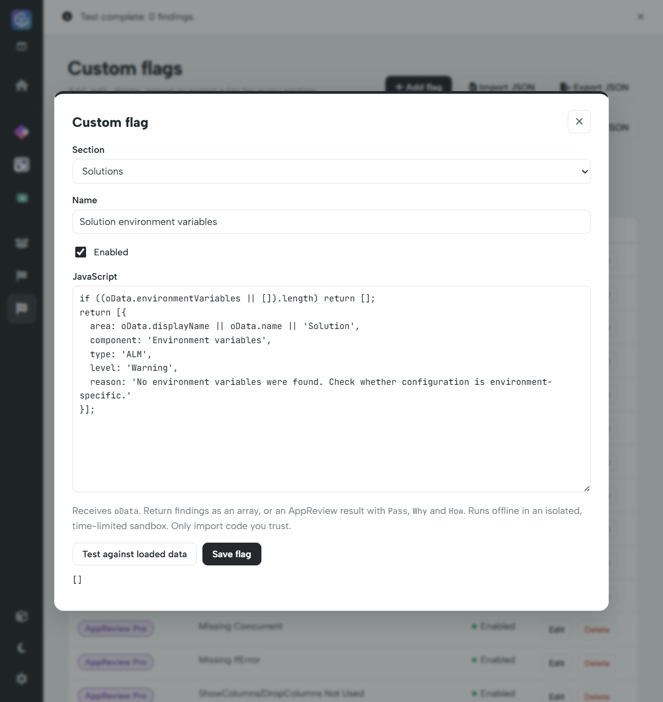

# Create and test a flag

## Before you write code

Decide which **exported field** proves or suggests the problem. Download the relevant section JSON and inspect a representative sample. If the data is unavailable—such as runtime duration, a user's sharing permissions or DLP policy—the rule cannot reliably check it.

Use the narrowest suitable section. App properties belong in Apps; flow internals in Automate; agent components in Copilot; shared metadata/dependencies in Solutions.

## Create a rule

1. Load a solution, validate Pro access, and open **Custom flags**.
2. Select the relevant section, then choose **Add flag**.
3. Choose **Section**, enter a descriptive **Name**, and leave **Enabled** checked to include it in scans.
4. Paste a JavaScript **function body**, not an entire HTML/script file or JSON entry. The input is already available as `oData`.
5. Choose **Test against loaded data**.
6. Inspect the output and any error banner. Adjust the rule and retest.
7. Choose **Save flag**, then open Flag report and **Run all flags**.



The screenshot uses a mocked test license. No real license data is included.

## A first Solutions rule

This checks for an empty solution inventory of environment variables. It is a team-policy example, not a universal requirement for every solution.

```javascript
if ((oData.environmentVariables || []).length) return [];
return [{
  area: oData.displayName || oData.name || 'Solution',
  component: 'Environment variables',
  type: 'ALM',
  level: 'Warning',
  reason: 'No environment variables were found. Check whether configuration is environment-specific.'
}];
```

Test against both a solution with a variable and one without. The synthetic overview example has variables, so this rule returns an empty array there. To examine the finding format, use a suitable second export or one of the [example rules](examples.md).

## Understand testing

**Test against loaded data** runs against every data context in the selected section and shows normalised findings. Apps are checked independently. An empty output can mean the check passed **or** that there were no contexts of that type; verify the loaded component inventory first.

Testing does not save the rule. **Save flag** saves it but does not preserve a previous report as current. **Run all flags** refreshes the report using saved, enabled rules.

Test positive and negative cases, missing/empty fields and more than one app/flow/agent. For text-based heuristics, include comments and string literals that could cause false positives. Keep rule names unique within a section to avoid unexpected replacement during import.
