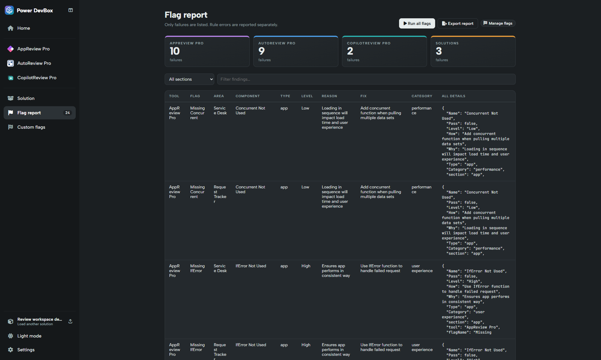

# Flag report

The central Flag report combines **custom-rule failures** across **Apps, Automate, Copilot and Solutions**. It requires a loaded solution and validated Power DevBox Pro access. The sidebar link becomes available after loading a solution.


**Power DevBox Pro required to run custom flags and view/export their report.** [Buy a license](https://power-devbox.lemonsqueezy.com/checkout/buy/729d48f6-cc59-477e-a601-ca99100ffeb3) and activate it in [Settings](../settings.md).


## Run and review

1. Load your solution and validate Pro access in Settings.
2. Open **Flag report** and choose **Run all flags**.
3. Watch the progress/counts until the scan finishes.
4. Review the four section totals, then select a section and/or enter a text filter.
5. Investigate the reason, suggested fix and any extra details.
6. Check **Rule execution errors**, even if the finding total is low.

With Pro access, flags also run during solution loading. After adding, importing, deleting, disabling or editing a rule, the previous report is invalidated: **Run all flags** again.

## What a finding means

The table retains Tool, Flag, Area, Component, Type, Level, Reason, Fix, Category and **All details**. AppReview-style fields such as `Why` and `How` are preserved and mapped into the common presentation. Additional fields remain available in the full result.

Only failing results appear: an empty array or AppReview `Pass: true` produces no row. A total is a count of **finding rows**, not unique defects or the number of rules that failed. Severity/type labels come from the rule; they are not a centrally enforced risk rating.

## Scoped reports

Within a reviewer, the header flag button opens the selected app/flow/agent's findings. **Flow Overview → All flow flags** opens findings for every flow. **Solution → Custom flags** shows Solutions findings. These are scoped presentations of the same workspace scan, not separate rule libraries.

Use **All flags** to return to this combined report or **Manage flags** to change the appropriate library.

## Execution errors

A rule can fail to execute because of a missing field, incorrect case, invalid output, unsupported asynchronous operation or sandbox timeout. These failures appear separately with section, rule, context and error text. Successful findings from other rules are retained.

**An execution error is not a passing check.** Fix or deliberately disable the rule, then rerun the scan. If the input data cannot support the check, document that limitation rather than inventing fields.

## Export report

**Export report** downloads JSON containing solution name/version, generation time, four section totals, findings and errors. It exports the scan result rather than only the currently visible filtered rows. For rule definitions use **Custom flags → Export JSON** instead.
