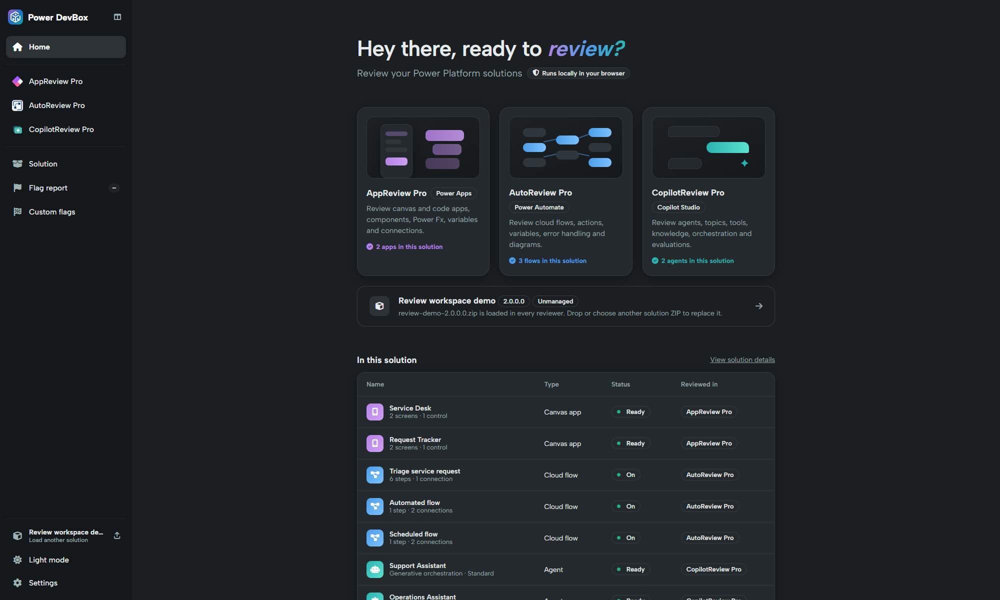

# Getting started

Use an exported solution to review the configuration and source included in that package. You do not need to connect the reviewer to a Power Platform environment.

## Before you begin

Have a **managed or unmanaged Power Platform solution ZIP** containing the components you want to review. Export the solution from Power Apps or the relevant maker experience, following your organisation's normal export process. Keep the ZIP intact: do not unzip it or select an individual file from inside it.

Use a current browser. A desktop-sized window is easiest for code, wide tables and diagrams. No account is required for the standard review. Have your Power DevBox Pro key available only if you plan to use custom flags or comparison.


**License needed only for custom flags and comparison.** Standard reviews and solution browsing are free. [Buy Power DevBox Pro](https://power-devbox.lemonsqueezy.com/checkout/buy/729d48f6-cc59-477e-a601-ca99100ffeb3) and activate it in [Settings](settings.md) to use the paid features.


## Load your first solution

1. [Open the application](https://review.powerdevbox.com/).
2. On **Home**, select **Load a solution to review**, or drop the exported ZIP onto that row. The solution button near the bottom of the sidebar also opens the file picker.
3. Watch the progress bar. The app reads the ZIP, checks archive limits and integrity, parses the solution and prepares the three reviewers. With validated Pro access, custom flags also run during loading.
4. Wait for **Solution Loaded**. Home shows the solution name, version, managed status and component counts.
5. Choose an app, flow or agent from **In this solution**, or open a reviewer from the sidebar.
6. Open **Solution** to check shared metadata, dependencies and files.

**Expected result:** the same loaded solution is available to every reviewer. A reviewer can legitimately show no items if the export contains no components of that type.

## A practical first-pass review

1. Confirm the solution name and version in [Solution](solution/README.md).
2. Check app [Overview and code](appreview-pro/README.md), then variables and data access.
3. Use [Flow Overview](autoreview-pro/README.md) to choose flows, then inspect triggers, actions and exception handling.
4. Check agent [instructions and capabilities](copilotreview-pro/README.md), particularly authentication, tools and connections.
5. If you use Pro, run [all custom flags](flags/flag-report.md), review execution errors and investigate findings.
6. [Export the useful views](navigation-and-exports.md#exports) and record decisions separately from automated findings.

## Replacing or reopening a solution

Choose another ZIP using the loaded-solution button or the Home solution row. This replaces the current review baseline. **Last opened** stores names and summary information, not solution files: selecting a recent item asks you to choose its ZIP again. Refreshing or closing the app also means you need to reload the file.

To compare versions, do not replace the newer solution with the older file. Follow [Compare solution versions](comparing-versions.md).
