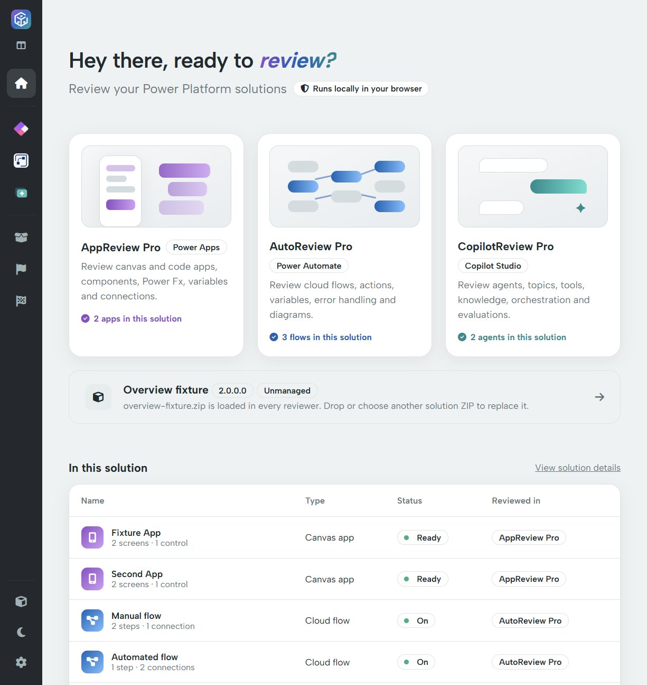

# Home

Home is the starting point for loading a solution and moving between the reviewers.

## Reviewer cards

The three cards open **AppReview Pro**, **AutoReview Pro** and **CopilotReview Pro**. Once a solution is loaded, each card shows its component count. Open a card to enter that reviewer's own navigation; opening one before loading a solution instead offers a solution picker.

The reviewers share the ZIP, but show different evidence. An app's flow reference is not a replacement for an AutoReview inspection of that flow's actions. An agent's flow summary likewise does not contain the complete action-level review.

## Loaded solution

The wide row identifies the current solution, version and managed/unmanaged status. Its filename helps you distinguish the package from another export with a similar display name. Select it to choose a replacement ZIP.

**In this solution** lists the parsed apps, flows and agents, with summary details and the reviewer that handles each type. Select a row to open that reviewer, then select the required component in its menu.

## Last opened

When no file is loaded, Home can show previously opened solution names, versions, dates and counts. This is a convenience list, not a document store. Choose the original ZIP again to reopen it. **Clear** removes the recent list; it does not delete your exported ZIP from disk.

See [Privacy and safe sharing](privacy.md) for what stays in browser storage.
