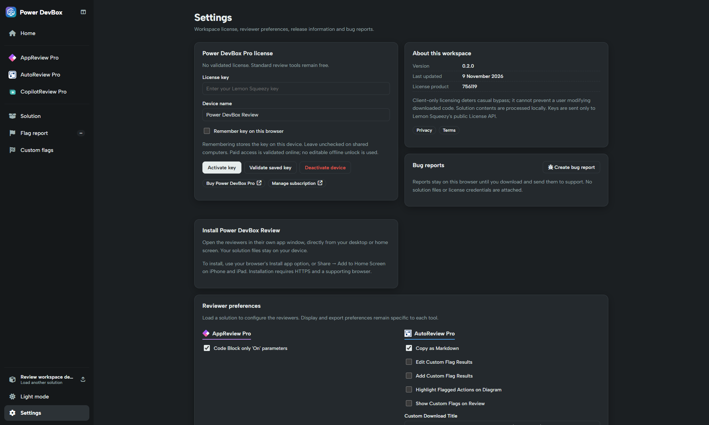

# Settings and licensing

Settings centralises the workspace license, release information, reviewer preferences, installation and local bug reports.

## Activate Power DevBox Pro

Standard review is free. Only custom flags and version comparison require Pro.


**Need custom flags or comparison?** [Buy Power DevBox Pro](https://power-devbox.lemonsqueezy.com/checkout/buy/729d48f6-cc59-477e-a601-ca99100ffeb3), then follow the activation steps below. No purchase is needed for standard review.


1. Open **Settings**.
2. Enter your **License key** and a meaningful **Device name**.
3. Select **Remember key on this browser** only on a device/profile where storing it is appropriate.
4. Choose **Activate key** and wait for online validation.
5. Return to Custom flags or Compare. If you came from a locked flag page, successful activation can return you there automatically without losing the loaded solution.

The app validates the license through Lemon Squeezy's public License API, checking the product, status, expiry and activation instance. A saved key alone does not unlock Pro. The current product ID is **756119**.

## Remember, validate and deactivate

* **Remember key on this browser** stores credentials in this browser origin. Leave it unchecked on shared computers. Without remembering, activation can be used in the current session, but a reload may require entering the key again.
* **Validate saved key** forces an online check of available credentials. Successful validation is held in memory for up to five minutes; later paid operations can revalidate.
* **Deactivate device** requests online deactivation and removes the local saved key after success. It is not a subscription-cancellation action.
* **Manage subscription** opens billing. [**Buy Power DevBox Pro**](https://power-devbox.lemonsqueezy.com/checkout/buy/729d48f6-cc59-477e-a601-ca99100ffeb3) opens the purchase destination. Read the current commercial terms there; this guide does not promise an activation allowance or subscription price.

Remembered keys are accessible to code with access to this site's browser storage. Use the hosted HTTPS app and do not share browser profiles casually.

## About this workspace

The About panel reports the workspace version, update date, license product and privacy/terms links. Use this version when reporting a problem; embedded reviewer version labels can differ from the combined workspace release.

## Reviewer preferences

Load a solution so the reviewer adapters are available, then return to Settings. Each reviewer exposes its own options; the workspace's light/dark setting remains shared.

* AppReview exposes the **Code Block only 'On' parameters** preference.
* AutoReview exposes copy/export settings, flag display/highlighting, download-title and filter-shortcut options.
* CopilotReview exposes copy/export settings, flag display, **Show System Topics**, download-title and filter-shortcut options.

Options affect their corresponding reviewer, not the input ZIP or a live environment. The central flag library and report remain authoritative for custom-rule definitions and execution.

## Bug reports

Choose **Create bug report**, describe the issue and save it. Reports are stored **locally**, not submitted automatically. Download the saved report and send it through your normal support channel yourself.

The app does not automatically attach solution contents or license credentials. However, anything you type into the description becomes part of the report: do not paste keys, sensitive source or personal data. See [Troubleshooting](troubleshooting.md) for useful reproduction details.
