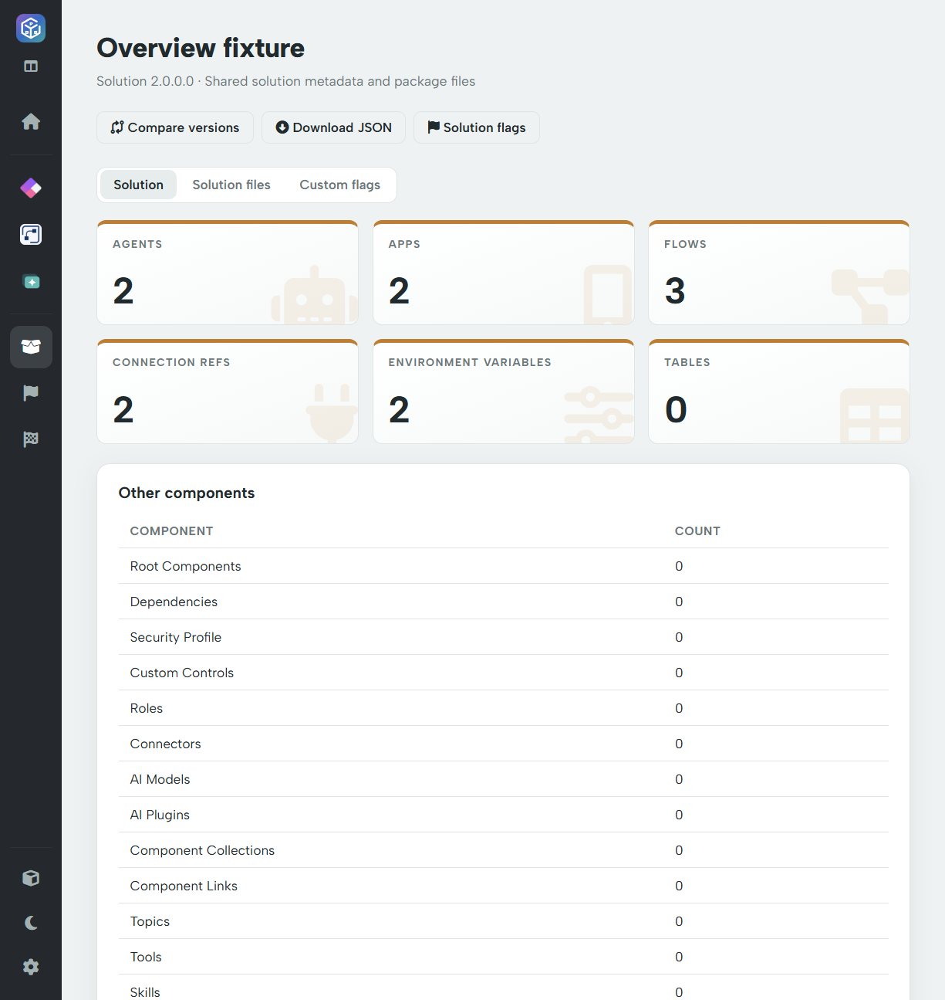

# Solution information

The workspace's **Solution** section owns shared metadata, component inventories, package files and solution-level custom findings. You do not need a license to browse the standard information.

## Solution tab

Start with the solution name/version and summary cards for agents, apps, flows, connection references, environment variables and tables. **Other components** summarises additional inventories. Scroll to **Solution information** for the available metadata and expand component lists to inspect their records.

The lists reflect what the parser found in the package: for example, root components, missing dependencies, connection references, variables, tables and other supported component types. They are not a live environment inventory.

Check unique name, display name, version, publisher and managed status before reviewing dependencies or comparing packages. A solution with an empty component inventory may simply not contain that type; use raw files to investigate unexpected omissions.

## Three tabs

| Tab | Purpose |
| --- | --- |
| **Solution** | Shared metadata and parsed component inventories. |
| **Solution files** | Searchable tree, preview and download of original package entries. |
| **Custom flags** | Embedded solution-level findings; Pro required. |

## Header actions

* **Compare versions** starts comparison across the reviewers against an older ZIP of the same solution.
* **Download JSON** exports shared solution data. It includes inventories and enriched flow review metadata used by solution rules; it is not a byte-for-byte copy of the ZIP.
* **Solution flags** opens the same embedded report as the Custom flags tab.

## Solution custom flags

Rules in **Solutions** inspect shared fields, rather than running once per app or agent. Default solution rules are seeded from the AutoReview pack only, avoiding duplicate solution checks from all three tools.

In the embedded report, use **Run flags** to refresh, **Manage flags** for the Solutions library and **All flags** for the combined report. Solution findings do not necessarily belong to an individual app, action or topic. See [Input data and output contract](../flags/custom-flags/data-and-output.md).
