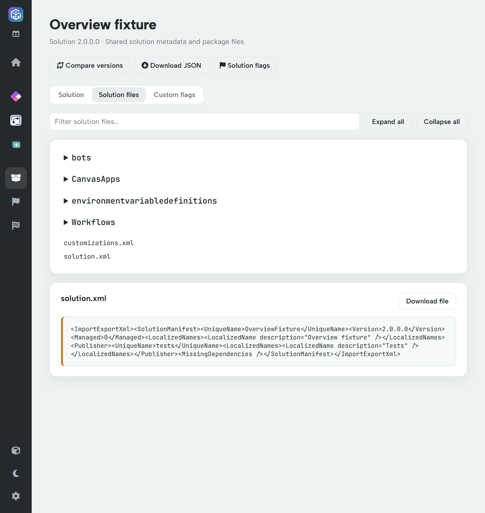

# Solution files

Use **Solution → Solution files** to inspect the files actually included in the loaded ZIP, without extracting the package manually.

## Browse and search

1. Open **Solution** and choose **Solution files**.
2. Expand a folder, or use **Expand all**.
3. Type part of a filename or path into **Filter solution files**. Matching folders expand to show results.
4. Select a filename to open its preview.
5. Use **Download file** to save that entry locally. **Collapse all** closes the expanded tree.

The filter matches the file path, not the contents of every file. To search source content, use the relevant reviewer or download the entry.

## Preview behaviour

Recognised text files under the preview size limit are displayed as text, including XML, JSON, YAML and common source/text formats. Files at or above roughly **1 MiB**, binary files and unrecognised formats show **Binary or large file. Download to inspect it.** instead.

An embedded `.msapp` remains a package file in this tree; it is not automatically expanded as another folder here. Use AppReview's extracted views for app content or inspect the downloaded package using appropriate tooling.

## Use raw files as supporting evidence

For example, inspect `solution.xml` to confirm manifest details or a workflow JSON to investigate an extracted action. The viewer does not modify package contents, save edits back to the ZIP or import the solution into an environment.

Raw files can contain configuration values, source and identifiers that the summary UI does not display. Check them before sending them to support, an AI assistant or another organisation.
